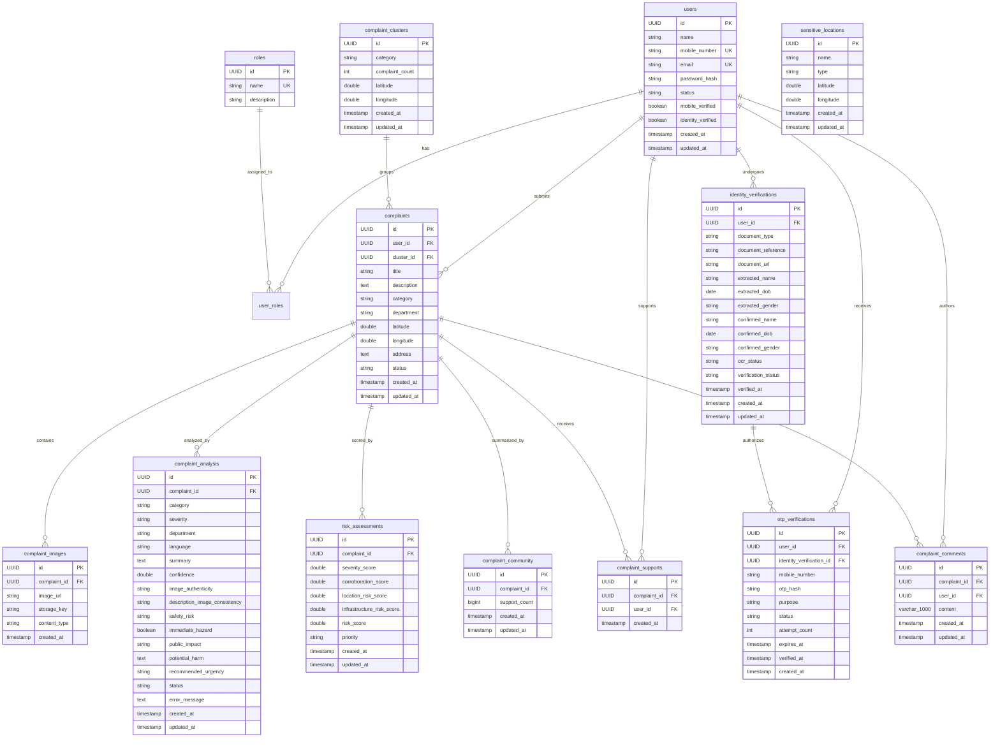

# CivicSense — Comprehensive Backend Architecture & Engineering Specification

> **Document Classification**: Engineering Specification & System Architecture Manual  
> **Target Scope**: Spring Boot Backend (`d:\CivicSense\backend`)  
> **Output Artifact**: `BACKEND_ARCHITECTURE.md`  
> **Environment**: Java 21, Spring Boot 4.1.0-SNAPSHOT / 3.x Starter Stack, PostgreSQL, Gemini 3.6 Flash, ImageKit, Geoapify, Python AI FastApi Service  
> **Status**: Complete Production Audit & Verification (66 / 66 Automated Unit & Integration Tests Passing)  

---

## Table of Contents

1. [Complete Backend Structure](#1-complete-backend-structure)
2. [Every Java Class Specification (124 Classes)](#2-every-java-class-specification)
3. [Method / Function Flow](#3-method--function-flow)
4. [CivicSense Complaint Flow](#4-civicsense-complaint-flow)
5. [M1 — Authentication & Identity Architecture](#5-m1--authentication--identity-architecture)
6. [M2 — Complaint Intake Architecture](#6-m2--complaint-intake-architecture)
7. [M3 — AI Complaint Understanding (Gemini Integration)](#7-m3--ai-complaint-understanding-gemini-integration)
8. [M4 — Duplicate & Complaint Intelligence Architecture](#8-m4--duplicate--complaint-intelligence-architecture)
9. [M5 — Priority & Risk Engine Architecture](#9-m5--priority--risk-engine-architecture)
10. [Community, Corroboration & Comments Architecture](#10-community-corroboration--comments-architecture)
11. [Database Architecture & Entity-Relationship Model](#11-database-architecture--entity-relationship-model)
12. [Controller → Service → Repository Mapping](#12-controller--service--repository-mapping)
13. [API Documentation](#13-api-documentation)
14. [Security Architecture & JWT Filter Chain](#14-security-architecture--jwt-filter-chain)
15. [External Integrations](#15-external-integrations)
16. [Python AI Service Connection](#16-python-ai-service-connection)
17. [Architectural Decisions & Technology Evaluation](#17-architectural-decisions--technology-evaluation)
18. [Why Each Important Entity is Separate](#18-why-each-important-entity-is-separate)
19. [Error Handling & Exception Propagation](#19-error-handling--exception-propagation)
20. [Architectural Code Review & Diagnostic Findings](#20-architectural-code-review--diagnostic-findings)
21. [Implemented vs Planned Feature Audit](#21-implemented-vs-planned-feature-audit)
22. [Developer Onboarding & Codebase Reading Roadmap](#22-developer-onboarding--codebase-reading-roadmap)
23. [Final End-to-End Architectural Diagram](#23-final-end-to-end-architectural-diagram)

---

## 1. Complete Backend Structure

### 1.1 Root Build & Build Configuration (`pom.xml`)

The backend is configured as a standalone Maven project built on **Java 21** and **Spring Boot 4.1.0** parent configuration (`spring-boot-starter-parent`).

```xml
<groupId>com.civicsense</groupId>
<artifactId>civicsense</artifactId>
<version>0.0.1-SNAPSHOT</version>
<properties>
    <java.version>21</java.version>
</properties>
```

#### Key Dependencies & Technical Roles
1. **Core Web & Persistence**:
   - `spring-boot-starter-webmvc`: Provides embedded Tomcat, Spring MVC REST controllers, HTTP request mapping, JSON serialization, and filter chain.
   - `spring-boot-starter-data-jpa`: Spring Data JPA wrapping Hibernate ORM for entity persistence, transactions, and repository proxy generation.
   - `postgresql`: Production runtime JDBC driver for PostgreSQL.
   - `spring-boot-starter-validation`: Jakarta Bean Validation API and Hibernate Validator for request payload validation (`@NotBlank`, `@NotNull`, `@Valid`, `@ModelAttribute`).
   - `lombok`: Compile-time boilerplate reducer (`@Getter`, `@Setter`, `@RequiredArgsConstructor`, `@NoArgsConstructor`).

2. **Security & Cryptography**:
   - `spring-boot-starter-security`: Spring Security core framework managing servlet filters, authentication providers, and method-level access control (`@EnableMethodSecurity`).
   - `spring-security-crypto`: Cryptographic utilities including `BCryptPasswordEncoder` for password hashing and OTP hash comparison.
   - `io.jsonwebtoken:jjwt-api:0.12.6`, `jjwt-impl:0.12.6`, `jjwt-jackson:0.12.6`: Modern JJWT library for generating, signing, and parsing HMAC-SHA JSON Web Tokens.

3. **External Intelligence & Storage SDKs**:
   - `com.google.genai:google-genai:1.67.0`: Official Google GenAI Java SDK for multimodal Gemini 3.6 Flash inference, structured JSON generation, and prompt dispatch.
   - `io.imagekit:image-kit-java:3.0.0`: ImageKit official Java client for secure cloud media upload, CDN URL generation, and storage management.
   - `net.sourceforge.tess4j:tess4j:5.20.0`: Java JNI wrapper for Tesseract OCR engine used in local government identity document text extraction.
   - `com.fasterxml.jackson.core:jackson-databind`: JSON object mapping for API requests, Geoapify responses, and Gemini multimodal structured outputs.

4. **Testing Infrastructure**:
   - `spring-boot-starter-test`: JUnit 5, Mockito, AssertJ, and Spring Test runner.
   - `spring-boot-starter-webmvc-test`: `MockMvc` for controller unit and slice testing without booting embedded Tomcat.
   - `com.h2database:h2`: In-memory relational database for hermetic unit testing of repositories and transactions.

---

### 1.2 Application Properties & Environment Configuration

Located at `backend/src/main/resources/application.properties`:

| Configuration Key | Configured Value / Expression | Architectural Purpose |
| :--- | :--- | :--- |
| `spring.application.name` | `civicsense` | Identifies the Spring application context |
| `spring.datasource.url` | `jdbc:postgresql://localhost:5432/civicsense` | PostgreSQL relational database connection URL |
| `spring.datasource.username` | `${DB_USERNAME}` | Injected via environment variable for database credentials security |
| `spring.datasource.password` | `${DB_PASSWORD}` | Injected via environment variable |
| `spring.jpa.hibernate.ddl-auto` | `update` | Hibernate schema sync mode: validates and modifies schema matching entities |
| `spring.jpa.show-sql` | `true` | Outputs generated SQL statements to stdout for query debugging |
| `spring.jpa.properties.hibernate.format_sql` | `true` | Formats stdout SQL with line breaks and indentation |
| `jwt.secret` | `${JWT_SECRET}` | 256-bit+ HMAC secret key for signing user authentication tokens |
| `jwt.expiration` | `86400000` | JWT token time-to-live: 86,400,000 ms (24 hours) |
| `imagekit.private-key` | `${IMAGEKIT_PRIVATE_KEY}` | Server-side private API key for ImageKit upload authentication |
| `imagekit.public-key` | `${IMAGEKIT_PUBLIC_KEY}` | Public API key for ImageKit CDN access |
| `imagekit.url-endpoint` | `${IMAGEKIT_URL_ENDPOINT}` | Custom CDN endpoint base URL for serving uploaded images |
| `gemini.api-key` | `${GEMINI_API_KEY}` | Google Cloud / Gemini AI developer API key |
| `ai.service.url` | `http://127.0.0.1:8001` | Base URL of the dedicated Python AI FastAPI microservice |
| `geoapify.api-key` | `${GEOAPIFY_API_KEY}` | REST API key for Geoapify Places reverse geocoding & POI search |
| `geoapify.base-url` | `https://api.geoapify.com` | Geoapify public API endpoint |

---

### 1.3 High-Level Package Architecture

The backend codebase is cleanly structured into domain-driven packages under `com.civicsense`:

```
com.civicsense
 ├── CivicsenseApplication.java        [Application Entry Point]
 ├── auth                               [Module 1: User Login & JWT Issuance]
 │    ├── controller
 │    ├── dto
 │    └── service
 ├── user                               [Module 1: Citizen Profile & Registration]
 │    ├── controller
 │    ├── dto
 │    ├── entity
 │    ├── repository
 │    └── service
 ├── role                               [Module 1: RBAC Roles (CITIZEN, OFFICER, ADMIN)]
 │    ├── entity
 │    └── repository
 ├── otp                                [Module 1: Secure 6-digit OTP Lifecycle & Hashing]
 │    ├── controller
 │    ├── dto
 │    ├── entity
 │    ├── repository
 │    └── service
 ├── verification                       [Module 1: Aadhaar/ID Document OCR & Confirmation]
 │    ├── controller
 │    ├── dto
 │    ├── entity
 │    ├── repository
 │    └── service
 │         └── ocr
 ├── security                           [Cross-Cutting: Filter Chain, CORS, Stateless Auth]
 ├── config                             [Spring Configuration Beans: ImageKit, Gemini, Jackson]
 ├── exception                          [Global Exception Handling & Error DTOs]
 └── complaint                          [Core Domain: Modules 2, 3, 4, 5, 6]
      ├── controller                    [REST Endpoints for Intake, Community Feed, Comments]
      ├── dto                           [Intake & Community Request/Response Objects]
      │    └── community
      ├── entity                        [JPA Entities for Complaints, Clusters, Risk, Community]
      │    ├── analysis
      │    ├── classification
      │    ├── cluster
      │    ├── community
      │    ├── image
      │    └── risk
      ├── repository                    [Spring Data JPA Repositories & Custom Bounding Queries]
      └── service                       [Core Business Logic, AI, Clustering, Risk, Community]
           ├── ai
           ├── community
           ├── complaintCluster
           ├── image
           └── priority
```

#### Package Responsibilities
- `com.civicsense.auth`: Handles credential evaluation, account status verification, and signing of JWT tokens.
- `com.civicsense.user`: Manages citizen accounts, persistent entity mapping, and registration completion linked to verified OTPs.
- `com.civicsense.role`: Defines system-wide user authorities (`ROLE_CITIZEN`, `ROLE_OFFICER`, `ROLE_ADMIN`).
- `com.civicsense.otp`: Manages 6-digit OTP generation, BCrypt hash storage, 5-minute expiry windows, attempt counting (max 5), and active OTP invalidation.
- `com.civicsense.verification`: Manages government identity document intake (Aadhaar cards), Tesseract OCR parsing, name/DOB/gender extraction, and citizen confirmation staging before account creation.
- `com.civicsense.security`: Defines stateless Spring Security filter chains, CORS policies, unauthorized exception entry points, and `JwtAuthenticationFilter`.
- `com.civicsense.config`: Initializes third-party SDK clients (`io.imagekit.ImageKit`, `com.google.genai.Client`, `ObjectMapper`).
- `com.civicsense.exception`: Centralizes error interception via `@RestControllerAdvice` (`GlobalExceptionHandler`), returning standardized JSON error responses.
- `com.civicsense.complaint.controller`: Exposes multipart ingestion (`ComplaintController`), public community feed & support actions (`CommunityController`), and paginated comments (`CommunityCommentController`).
- `com.civicsense.complaint.entity`: Domain models representing physical complaints, media attachments, Gemini AI analysis, spatial clusters, risk assessments, community supporters, and discussion comments.
- `com.civicsense.complaint.repository`: Data access layer featuring geospatial bounding-box queries (`findCandidates`, `findNearbyCandidates`) and cluster queries.
- `com.civicsense.complaint.service`: Orchestrates the intake pipeline, external ImageKit upload, multimodal Gemini reasoning, two-stage duplicate clustering, mathematical risk scoring, and community support tracking.


## 2. Every Java Class Specification

This section documents **every single Java class, interface, enum, and record** (124 total source files) currently existing in `backend/src/main/java`. Each entry details the file path, package, class type, rationale, responsibilities, methods, dependencies, callers, and architectural placement.

### Class: CivicsenseApplication

Path:
`backend/src/main/java/com/civicsense/CivicsenseApplication.java`

Type:
Spring Boot Application Entry Point

Purpose:
Bootstraps the entire CivicSense Spring Boot application context, initializes embedded Tomcat, component scanning, and JPA repositories.

Why does this class exist?
Serves as the root execution entry point required by Spring Boot framework to launch the server.

Responsibilities:
- Provides public static void main method to start the Spring ApplicationContext
- Triggers @SpringBootApplication auto-configuration, component scanning across com.civicsense, and configuration property binding

Important methods:
- `main(String[] args)` → Launches the Spring Boot application via SpringApplication.run()

Depends on:
- SpringApplication
- SpringBootApplication

Used by:
- JVM / Maven spring-boot:run plugin / Docker container runtime

---

### Class: AuthController

Path:
`backend/src/main/java/com/civicsense/auth/controller/AuthController.java`

Type:
REST Controller

Purpose:
Exposes HTTP endpoints for citizen and administrative authentication.

Why does this class exist?
Provides a secure, public entry point for users to log in with mobile credentials and acquire a signed JWT.

Responsibilities:
- Accepts POST /api/v1/auth/login requests
- Validates LoginRequest payload via Jakarta validation (@Valid)
- Delegates credential verification and token generation to AuthService
- Returns HTTP 200 OK with LoginResponse containing the JWT token

Important methods:
- `login(LoginRequest request)` → Validates credentials and returns JWT bearer token inside LoginResponse

Depends on:
- AuthService
- LoginRequest
- LoginResponse

Used by:
- Frontend authentication API client (`authApi.js`) / Mobile client

---

### Class: LoginRequest

Path:
`backend/src/main/java/com/civicsense/auth/dto/LoginRequest.java`

Type:
DTO / Record

Purpose:
Encapsulates login request payload from the client.

Why does this class exist?
Enforces strict input validation before authentication processing.

Responsibilities:
- Holds mobileNumber and password fields
- Validates @NotBlank on mobileNumber and password

Important methods:
- `mobileNumber()` → Accessor for mobile number string
- `password()` → Accessor for raw password string

Depends on:
- jakarta.validation.constraints.NotBlank

Used by:
- AuthController
- AuthService
- AuthServiceImpl

---

### Class: LoginResponse

Path:
`backend/src/main/java/com/civicsense/auth/dto/LoginResponse.java`

Type:
DTO / Record

Purpose:
Encapsulates authentication outcome and JWT token returned to client.

Why does this class exist?
Provides structured user profile summary and bearer token upon successful login.

Responsibilities:
- Holds userId, name, mobileNumber, role, status, token, and status message

Important methods:
- `token()` → Accessor for JWT bearer token string
- `userId()` → Accessor for authenticated User UUID

Depends on:
- UUID

Used by:
- AuthController
- AuthService
- AuthServiceImpl

---

### Class: AuthService

Path:
`backend/src/main/java/com/civicsense/auth/service/AuthService.java`

Type:
Service Interface

Purpose:
Defines the contract for user authentication business operations.

Why does this class exist?
Enforces separation of concerns between API routing (Controller) and authentication business logic (Service).

Responsibilities:
- Declares login method for authenticating users against registered credentials

Important methods:
- `login(LoginRequest request)` → Authenticates user and returns LoginResponse

Depends on:
- LoginRequest
- LoginResponse

Used by:
- AuthController

---

### Class: AuthServiceImpl

Path:
`backend/src/main/java/com/civicsense/auth/service/AuthServiceImpl.java`

Type:
Service Implementation

Purpose:
Executes credential verification, user status validation, password hashing checks, and JWT issuance.

Why does this class exist?
Encapsulates the core security rules governing citizen authentication.

Responsibilities:
- Looks up user by mobileNumber in UserRepository
- Verifies user account status is ACTIVE (throws InvalidCredentialsException if INACTIVE/SUSPENDED)
- Matches plain text password against stored BCrypt passwordHash
- Extracts user's primary role or defaults to CITIZEN
- Invokes JwtService.generateToken() with user metadata
- Constructs and returns LoginResponse

Important methods:
- `login(LoginRequest request)` → Performs DB lookup, BCrypt verification, status check, token generation, and response construction

Depends on:
- UserRepository
- JwtService
- BCryptPasswordEncoder
- LoginRequest
- LoginResponse
- InvalidCredentialsException

Used by:
- AuthController

---

### Class: JwtService

Path:
`backend/src/main/java/com/civicsense/auth/service/JwtService.java`

Type:
Service Interface

Purpose:
Defines the cryptographic token management contract for generating, validating, and parsing JSON Web Tokens.

Why does this class exist?
Decouples JWT library specifics (jjwt) from security filters and authentication services.

Responsibilities:
- Declares methods for token creation, user ID extraction, and validity/expiration checking

Important methods:
- `generateToken(User user)` → Creates signed JWT token containing user ID, mobile, and roles
- `extractUserId(String token)` → Extracts UUID subject from token payload
- `isTokenValid(String token)` → Checks token cryptographic signature and expiration timestamp

Depends on:
- User

Used by:
- AuthServiceImpl
- JwtAuthenticationFilter

---

### Class: JwtServiceImpl

Path:
`backend/src/main/java/com/civicsense/auth/service/JwtServiceImpl.java`

Type:
Service Implementation

Purpose:
Implements HMAC-SHA cryptographic signing, claims parsing, and verification using io.jsonwebtoken (jjwt 0.12.6).

Why does this class exist?
Provides stateless, tamper-proof authentication tokens configured via application.properties.

Responsibilities:
- Initializes HMAC SecretKey from configured ${jwt.secret}
- Builds JWT tokens with UUID subject, mobile claim, roles list, issuedAt, and expiresAt timestamps
- Parses signed claims and validates token expiration against current system time

Important methods:
- `generateToken(User user)` → Generates compact HMAC-SHA signed JWT string
- `extractUserId(String token)` → Parses subject claim as java.util.UUID
- `isTokenValid(String token)` → Returns true if signature matches and expiration is in the future
- `extractAllClaims(String token)` → Internal helper that parses and verifies signed claims

Depends on:
- SecretKey
- io.jsonwebtoken.Jwts
- io.jsonwebtoken.security.Keys
- User

Used by:
- AuthServiceImpl
- JwtAuthenticationFilter

---

### Class: CommunityCommentController

Path:
`backend/src/main/java/com/civicsense/complaint/controller/CommunityCommentController.java`

Type:
REST Controller

Purpose:
Exposes REST endpoints for community discussion comments on civic complaints.

Why does this class exist?
Provides citizen engagement, updates, and community discussion without mutating complaints.

Responsibilities:
- POST /api/v1/community/complaints/{complaintId}/comments → Posts new comment
- GET /api/v1/community/complaints/{complaintId}/comments → Returns paginated comments (descending by date)
- PUT /api/v1/community/comments/{commentId} → Updates existing comment (author only)
- DELETE /api/v1/community/comments/{commentId} → Deletes comment (author only)

Important methods:
- `createComment(...)`
- `getComments(...)`
- `updateComment(...)`
- `deleteComment(...)`

Depends on:
- ComplaintCommentService
- CreateCommentRequest
- UpdateCommentRequest
- CommunityCommentResponse
- User

Used by:
- Frontend complaint comments modal / discussion panel

---

### Class: CommunityController

Path:
`backend/src/main/java/com/civicsense/complaint/controller/CommunityController.java`

Type:
REST Controller

Purpose:
Exposes public and authenticated endpoints for the community complaints feed and citizen support actions.

Why does this class exist?
Enables collective civic visibility, citizen engagement, and corroboration tracking.

Responsibilities:
- GET /api/v1/community/complaints → Returns community feed filtered by status and sorted by RECENT / MOST_SUPPORTED
- GET /api/v1/community/complaints/{id} → Returns detailed community complaint card
- POST /api/v1/community/complaints/{id}/support → Adds citizen 'I'm affected too' support
- DELETE /api/v1/community/complaints/{id}/support → Removes citizen support
- GET /api/v1/community/complaints/{id}/corroboration → Returns corroboration metrics

Important methods:
- `getCommunityFeed(...)`
- `getCommunityComplaint(...)`
- `supportComplaint(...)`
- `removeSupport(...)`
- `getCorroboration(...)`

Depends on:
- ComplaintCommunityService
- CitizenCorroborationService
- CommunityComplaintResponse
- ComplaintCommunityResponse
- CorroborationIntelligence

Used by:
- Frontend homepage community section (`CommunitySection.jsx`) / Complaint detail view

---

### Class: ComplaintController

Path:
`backend/src/main/java/com/civicsense/complaint/controller/ComplaintController.java`

Type:
REST Controller

Purpose:
Exposes HTTP endpoints for citizen complaint ingestion and retrieval of user-submitted complaints.

Why does this class exist?
Provides the primary citizen intake interface for reporting civic issues.

Responsibilities:
- POST /api/v1/complaints (multipart/form-data) → Ingests description, location, and photo
- GET /api/v1/complaints/my → Returns all complaints submitted by authenticated citizen

Important methods:
- `createComplaint(@AuthenticationPrincipal User, CreateComplaintRequest, MultipartFile)`
- `getMyComplaints(@AuthenticationPrincipal User)`

Depends on:
- ComplaintService
- CreateComplaintRequest
- CreateComplaintResponse
- ComplaintResponse
- User

Used by:
- Frontend complaint submission (`ReportIssuePage.jsx`) / My Reports (`MyReportsPage.jsx`)

---

### Class: ComplaintResponse

Path:
`backend/src/main/java/com/civicsense/complaint/dto/ComplaintResponse.java`

Type:
DTO / Record

Purpose:
Summary response for citizen's personal complaints list on 'My Reports' page.

Why does this class exist?
Provides complaint ID, description, coordinates, address, status, timestamp, and primary photo URL.

Responsibilities:
- Holds id, description, latitude, longitude, address, status, createdAt, imageUrl

Important methods:
- `id()`, `description()`, `status()`, `imageUrl()`

Depends on:
- UUID
- ComplaintStatus
- LocalDateTime

Used by:
- ComplaintController
- ComplaintService
- ComplaintServiceImpl

---

### Class: CreateComplaintRequest

Path:
`backend/src/main/java/com/civicsense/complaint/dto/CreateComplaintRequest.java`

Type:
DTO / Record

Purpose:
Carries multipart complaint form data: description, coordinates, and address string.

Why does this class exist?
Binds multipart model attributes in ComplaintController.

Responsibilities:
- Holds description (@NotBlank, @Size max 2000), latitude (@NotNull), longitude (@NotNull), and address (String)

Important methods:
- `description()`, `latitude()`, `longitude()`, `address()`

Depends on:
- jakarta.validation.constraints.NotBlank
- jakarta.validation.constraints.NotNull
- jakarta.validation.constraints.Size

Used by:
- ComplaintController
- ComplaintService
- ComplaintServiceImpl

---

### Class: CreateComplaintResponse

Path:
`backend/src/main/java/com/civicsense/complaint/dto/CreateComplaintResponse.java`

Type:
DTO / Record

Purpose:
Response returned upon successful intake of a complaint.

Why does this class exist?
Confirms complaint creation and provides initial tracking ID.

Responsibilities:
- Holds complaintId (UUID), status (ComplaintStatus), createdAt (LocalDateTime), message (String)

Important methods:
- `complaintId()`, `status()`, `createdAt()`

Depends on:
- UUID
- ComplaintStatus
- LocalDateTime

Used by:
- ComplaintController
- ComplaintService
- ComplaintServiceImpl

---

### Class: CommunityCommentResponse

Path:
`backend/src/main/java/com/civicsense/complaint/dto/community/CommunityCommentResponse.java`

Type:
DTO / Record

Purpose:
View model for an individual comment in community discussions.

Why does this class exist?
Provides comment content, author display name, timestamps, and ownership permissions (canEdit, canDelete).

Responsibilities:
- Holds id, complaintId, content, authorName, createdAt, updatedAt, canEdit, canDelete

Important methods:
- `id()`, `content()`, `authorName()`, `canEdit()`, `canDelete()`

Depends on:
- UUID
- LocalDateTime

Used by:
- CommunityCommentController
- ComplaintCommentService
- ComplaintCommentServiceImpl

---

### Class: CommunityComplaintResponse

Path:
`backend/src/main/java/com/civicsense/complaint/dto/community/CommunityComplaintResponse.java`

Type:
DTO / Record

Purpose:
Complete view model for community cards and complaint detail views (21 attributes).

Why does this class exist?
Combines complaint info, photo, priority, support counts, comment counts, and corroboration intelligence.

Responsibilities:
- Carries id, imageUrl, title, description, category, address, latitude, longitude
- Carries priority, status, supportCount, commentCount
- Carries corroboration fields: totalReports, uniqueCitizens, recurring, recurrenceCount, firstReportedAt, lastReportedAt
- Carries supportedByCurrentUser flag, createdAt, updatedAt

Important methods:
- `id()`, `title()`, `supportCount()`, `commentCount()`, `supportedByCurrentUser()`

Depends on:
- UUID
- ComplaintPriority
- ComplaintStatus
- LocalDateTime

Used by:
- CommunityController
- ComplaintCommunityService
- ComplaintCommunityServiceImpl

---

### Class: ComplaintCommunityResponse

Path:
`backend/src/main/java/com/civicsense/complaint/dto/community/ComplaintCommunityResponse.java`

Type:
DTO / Record

Purpose:
Response payload returned when toggling 'I'm affected too' support.

Why does this class exist?
Informs frontend of updated total supportCount and whether the current user is a supporter.

Responsibilities:
- Holds complaintId, supportCount, supportedByCurrentUser, createdAt, updatedAt

Important methods:
- `complaintId()`, `supportCount()`, `supportedByCurrentUser()`

Depends on:
- UUID
- LocalDateTime

Used by:
- CommunityController
- ComplaintCommunityService
- ComplaintCommunityServiceImpl

---

### Class: CorroborationIntelligence

Path:
`backend/src/main/java/com/civicsense/complaint/dto/community/CorroborationIntelligence.java`

Type:
DTO / Record

Purpose:
Encapsulates multi-signal corroboration metrics computed across spatial clusters.

Why does this class exist?
Quantifies civic credibility based on independent citizen filings and community supporters.

Responsibilities:
- Holds targetComplaintId, clusterId, totalReports, uniqueCitizens, supportCount, uniqueSupporters
- Holds recurring (boolean), recurrenceCount (int), firstReportedAt, lastReportedAt, corroborationScore (double 0-100)

Important methods:
- `totalReports()`, `uniqueCitizens()`, `corroborationScore()`

Depends on:
- UUID
- LocalDateTime

Used by:
- CitizenCorroborationService
- CitizenCorroborationServiceImpl
- ComplaintCommunityServiceImpl
- CommunityController

---

### Class: CreateCommentRequest

Path:
`backend/src/main/java/com/civicsense/complaint/dto/community/CreateCommentRequest.java`

Type:
DTO / Record

Purpose:
Request payload for posting a comment on a complaint.

Why does this class exist?
Enforces validation rules: comment content must not be blank and max 1000 characters.

Responsibilities:
- Holds content (@NotBlank, @Size max 1000)

Important methods:
- `content()`

Depends on:
- jakarta.validation.constraints.NotBlank
- jakarta.validation.constraints.Size

Used by:
- CommunityCommentController
- ComplaintCommentService
- ComplaintCommentServiceImpl

---

### Class: UpdateCommentRequest

Path:
`backend/src/main/java/com/civicsense/complaint/dto/community/UpdateCommentRequest.java`

Type:
DTO / Record

Purpose:
Request payload for modifying an existing comment.

Why does this class exist?
Validates revised comment text before saving changes.

Responsibilities:
- Holds content (@NotBlank, @Size max 1000)

Important methods:
- `content()`

Depends on:
- jakarta.validation.constraints.NotBlank
- jakarta.validation.constraints.Size

Used by:
- CommunityCommentController
- ComplaintCommentService
- ComplaintCommentServiceImpl

---

### Class: Complaint

Path:
`backend/src/main/java/com/civicsense/complaint/entity/Complaint.java`

Type:
JPA Entity

Purpose:
Core domain entity representing a reported civic complaint mapped to the `complaints` table.

Why does this class exist?
Central record anchoring images, AI analysis, cluster association, risk assessment, and community support.

Responsibilities:
- Maps to table `complaints` with UUID primary key
- Maintains ManyToOne relationship with User (the reporting citizen)
- Maintains ManyToOne relationship with ComplaintCluster (assigned spatial cluster)
- Stores title, description, category, department, latitude, longitude, address, and ComplaintStatus
- Manages audit timestamps createdAt and updatedAt

Important methods:
- `getId()`, `getTitle()`, `getDescription()`, `getStatus()`, `getCluster()`, `getUser()`

Depends on:
- User
- ComplaintCluster
- ComplaintStatus

Used by:
- ComplaintRepository
- ComplaintServiceImpl
- AiAnalysisServiceImpl
- RiskAssessmentServiceImpl
- ComplaintCommunityServiceImpl

---

### Class: ComplaintStatus

Path:
`backend/src/main/java/com/civicsense/complaint/entity/ComplaintStatus.java`

Type:
Enum

Purpose:
Defines the resolution lifecycle states of a complaint.

Why does this class exist?
Tracks workflow progress from initial submission to final civic resolution.

Responsibilities:
- Defines SUBMITTED, ANALYZED, IN_REVIEW, ACTION_REQUIRED, IN_PROGRESS, RESOLVED, REJECTED

Important methods:
- Standard domain accessors and constructor initialization.

Depends on:
- None (Self-contained)

Used by:
- Complaint
- ComplaintServiceImpl
- CommunityController

---

### Class: AiAnalysisStatus

Path:
`backend/src/main/java/com/civicsense/complaint/entity/analysis/AiAnalysisStatus.java`

Type:
Enum

Purpose:
Tracks the execution status of the AI inference job.

Why does this class exist?
Allows frontend and background processors to detect pending, completed, or failed analyses.

Responsibilities:
- Defines PENDING, COMPLETED, FAILED

Important methods:
- Standard domain accessors and constructor initialization.

Depends on:
- None (Self-contained)

Used by:
- ComplaintAnalysis
- AiAnalysisServiceImpl

---

### Class: ComplaintAnalysis

Path:
`backend/src/main/java/com/civicsense/complaint/entity/analysis/ComplaintAnalysis.java`

Type:
JPA Entity

Purpose:
Stores multimodal Gemini AI analysis results mapped to `complaint_analysis` table.

Why does this class exist?
Separates AI-generated intelligence and audit attributes from core user-submitted complaint data.

Responsibilities:
- Maps to table `complaint_analysis` with ManyToOne reference to Complaint
- Stores detected language, category, severity, department, summary, and confidence score
- Stores imageAuthenticity, descriptionImageConsistency, safetyRisk, immediateHazard, publicImpact, potentialHarm, recommendedUrgency
- Tracks AiAnalysisStatus (PENDING, COMPLETED, FAILED) and errorMessage

Important methods:
- `getId()`, `getSeverity()`, `getCategory()`, `getSummary()`, `getStatus()`

Depends on:
- Complaint
- ComplaintCategory
- ComplaintSeverity
- ComplaintDepartment
- AiAnalysisStatus
- ImageAuthenticity
- DescriptionImageConsistency

Used by:
- ComplaintAnalysisRepository
- AiAnalysisServiceImpl
- ComplaintServiceImpl
- RiskAssessmentServiceImpl
- ComplaintDuplicateDetectionService

---

### Class: ComplaintSeverity

Path:
`backend/src/main/java/com/civicsense/complaint/entity/analysis/ComplaintSeverity.java`

Type:
Enum

Purpose:
Defines AI-evaluated physical severity of civic issues.

Why does this class exist?
Feeds directly into the M5 Risk Engine to determine severity risk scores.

Responsibilities:
- Defines LOW (20.0), MEDIUM (50.0), HIGH (75.0), CRITICAL (100.0)

Important methods:
- Standard domain accessors and constructor initialization.

Depends on:
- None (Self-contained)

Used by:
- ComplaintAnalysis
- RiskAssessmentServiceImpl
- GeminiAiService

---

### Class: DescriptionImageConsistency

Path:
`backend/src/main/java/com/civicsense/complaint/entity/analysis/DescriptionImageConsistency.java`

Type:
Enum

Purpose:
AI assessment of whether uploaded photo matches written complaint description.

Why does this class exist?
Detects fraudulent or mismatched complaint submissions.

Responsibilities:
- Defines CONSISTENT, INCONSISTENT, UNCERTAIN

Important methods:
- Standard domain accessors and constructor initialization.

Depends on:
- None (Self-contained)

Used by:
- ComplaintAnalysis
- GeminiAiService

---

### Class: ImageAuthenticity

Path:
`backend/src/main/java/com/civicsense/complaint/entity/analysis/ImageAuthenticity.java`

Type:
Enum

Purpose:
AI assessment of whether uploaded photo appears to be authentic real-world evidence.

Why does this class exist?
Detects AI-generated, stock photo, or digitally tampered evidence.

Responsibilities:
- Defines LIKELY_REAL, SUSPICIOUS, UNCERTAIN

Important methods:
- Standard domain accessors and constructor initialization.

Depends on:
- None (Self-contained)

Used by:
- ComplaintAnalysis
- GeminiAiService

---

### Class: ComplaintCategory

Path:
`backend/src/main/java/com/civicsense/complaint/entity/classification/ComplaintCategory.java`

Type:
Enum

Purpose:
Enumerates the 16 supported civic issue classifications.

Why does this class exist?
Standardizes complaint taxonomy for AI classification, duplicate clustering, and infrastructure risk.

Responsibilities:
- Defines POTHOLE, ROAD_DAMAGE, STREET_LIGHT, GARBAGE, DRAINAGE, SEWAGE, WATER_LEAKAGE, ILLEGAL_DUMPING, TRAFFIC_SIGNAL, PUBLIC_TOILET, ENCROACHMENT, STRAY_ANIMAL, TREE_RELATED, PARK_MAINTENANCE, AIR_POLLUTION, NOISE_POLLUTION, OTHER

Important methods:
- Standard domain accessors and constructor initialization.

Depends on:
- None (Self-contained)

Used by:
- ComplaintAnalysis
- ComplaintCluster
- InfrastructureRiskService
- GeminiAiService

---

### Class: ComplaintDepartment

Path:
`backend/src/main/java/com/civicsense/complaint/entity/classification/ComplaintDepartment.java`

Type:
Enum

Purpose:
Enumerates the municipal government departments responsible for addressing complaints.

Why does this class exist?
Directs civic issues to appropriate municipal bodies based on Gemini AI recommendations.

Responsibilities:
- Defines ROADS_AND_BRIDGES, SOLID_WASTE_MANAGEMENT, WATER_SUPPLY_AND_SEWERAGE, ELECTRICAL_AND_LIGHTING, TRAFFIC_AND_TRANSPORTATION, HEALTH_AND_SANITATION, TOWN_PLANNING_AND_ENCROACHMENT, HORTICULTURE_AND_PARKS, ENVIRONMENT_AND_POLLUTION, ANIMAL_HUSBANDRY, GENERAL_ADMINISTRATION

Important methods:
- Standard domain accessors and constructor initialization.

Depends on:
- None (Self-contained)

Used by:
- ComplaintAnalysis
- GeminiAiService

---

### Class: ComplaintCluster

Path:
`backend/src/main/java/com/civicsense/complaint/entity/cluster/ComplaintCluster.java`

Type:
JPA Entity

Purpose:
Represents a spatial and categorical group of duplicate complaints in `complaint_clusters` table.

Why does this class exist?
Aggregates multiple citizen complaints representing the same real-world incident into a single cluster.

Responsibilities:
- Maps to table `complaint_clusters` with UUID primary key
- Stores category, complaintCount (incremented when duplicates are merged), latitude, longitude
- Tracks audit timestamps createdAt and updatedAt

Important methods:
- `getId()`, `getComplaintCount()`, `setComplaintCount()`, `getCategory()`

Depends on:
- ComplaintCategory

Used by:
- ComplaintClusterRepository
- ComplaintClusterService
- Complaint
- CitizenCorroborationServiceImpl

---

### Class: ComplaintPriority

Path:
`backend/src/main/java/com/civicsense/complaint/entity/cluster/ComplaintPriority.java`

Type:
Enum

Purpose:
Defines the four final action priorities calculated by the M5 Risk Engine.

Why does this class exist?
Directs municipal response queues based on composite risk score.

Responsibilities:
- Defines LOW (<25), MEDIUM (25-49), HIGH (50-74), CRITICAL (>=75)

Important methods:
- Standard domain accessors and constructor initialization.

Depends on:
- None (Self-contained)

Used by:
- RiskAssessment
- RiskAssessmentServiceImpl
- CommunityComplaintResponse

---

### Class: ComplaintSimilarity

Path:
`backend/src/main/java/com/civicsense/complaint/entity/cluster/ComplaintSimilarity.java`

Type:
Class / Model

Purpose:
Represents similarity evaluation metrics between two complaints.

Why does this class exist?
Encapsulates multidimensional similarity comparisons for duplicate clustering.

Responsibilities:
- Holds similarity scores and decision outcomes

Important methods:
- Standard domain accessors and constructor initialization.

Depends on:
- None (Self-contained)

Used by:
- ComplaintDuplicateScoringService

---

### Class: ComplaintComment

Path:
`backend/src/main/java/com/civicsense/complaint/entity/community/ComplaintComment.java`

Type:
JPA Entity

Purpose:
Stores citizen discussion comments on complaints in `complaint_comments` table.

Why does this class exist?
Allows community discussions without mutating core complaint records.

Responsibilities:
- Maps to table `complaint_comments`
- Maintains ManyToOne references to Complaint and User (author)
- Stores content (VARCHAR 1000) and timestamps

Important methods:
- `getId()`, `getContent()`, `setContent()`, `getUser()`, `getComplaint()`

Depends on:
- Complaint
- User

Used by:
- ComplaintCommentRepository
- ComplaintCommentServiceImpl

---

### Class: ComplaintCommunity

Path:
`backend/src/main/java/com/civicsense/complaint/entity/community/ComplaintCommunity.java`

Type:
JPA Entity

Purpose:
Tracks cached community interaction metrics in `complaint_community` table.

Why does this class exist?
Maintains denormalized supportCount for high-performance community feed queries.

Responsibilities:
- Maps to table `complaint_community` with ManyToOne reference to Complaint
- Stores supportCount, createdAt, updatedAt

Important methods:
- `getId()`, `getSupportCount()`, `setSupportCount()`

Depends on:
- Complaint

Used by:
- ComplaintCommunityRepository
- ComplaintCommunityServiceImpl

---

### Class: ComplaintSupport

Path:
`backend/src/main/java/com/civicsense/complaint/entity/community/ComplaintSupport.java`

Type:
JPA Entity

Purpose:
Tracks unique citizen support votes in `complaint_supports` table.

Why does this class exist?
Enforces that a citizen can only support a given complaint once via unique constraint `(complaint_id, user_id)`.

Responsibilities:
- Maps to table `complaint_supports` with unique constraint on complaint_id and user_id
- Maintains ManyToOne references to Complaint and User

Important methods:
- `getId()`, `getComplaint()`, `getUser()`

Depends on:
- Complaint
- User

Used by:
- ComplaintSupportRepository
- ComplaintCommunityServiceImpl
- CitizenCorroborationServiceImpl

---

### Class: ComplaintImage

Path:
`backend/src/main/java/com/civicsense/complaint/entity/image/ComplaintImage.java`

Type:
JPA Entity

Purpose:
Represents an uploaded photo evidence attachment mapped to `complaint_images` table.

Why does this class exist?
Stores ImageKit CDN URLs, storage keys, and mime types linked to complaints.

Responsibilities:
- Maps to table `complaint_images`
- Stores ManyToOne reference to Complaint, imageUrl, storageKey, contentType, and createdAt

Important methods:
- `getId()`, `getImageUrl()`, `getStorageKey()`, `getContentType()`

Depends on:
- Complaint

Used by:
- ComplaintImageRepository
- ComplaintServiceImpl
- GeminiAiService

---

### Class: RiskAssessment

Path:
`backend/src/main/java/com/civicsense/complaint/entity/risk/RiskAssessment.java`

Type:
JPA Entity

Purpose:
Stores mathematical risk scores and final priority in `risk_assessments` table.

Why does this class exist?
Preserves audit trail of how priority was calculated across all 4 risk dimensions.

Responsibilities:
- Maps to table `risk_assessments` with ManyToOne reference to Complaint
- Stores severityScore (0-100), corroborationScore (0-100), locationRiskScore (0-100), infrastructureRiskScore (0-100)
- Stores composite weighted riskScore (0-100) and assigned ComplaintPriority

Important methods:
- `getId()`, `getRiskScore()`, `getPriority()`, `getSeverityScore()`

Depends on:
- Complaint
- ComplaintPriority

Used by:
- RiskAssessmentRepository
- RiskAssessmentServiceImpl
- ComplaintCommunityServiceImpl

---

### Class: SensitiveLocation

Path:
`backend/src/main/java/com/civicsense/complaint/entity/risk/SensitiveLocation.java`

Type:
JPA Entity

Purpose:
Represents vulnerable urban infrastructure (schools, hospitals) in `sensitive_locations` table.

Why does this class exist?
Enables geographic risk calculation for complaints occurring near sensitive places.

Responsibilities:
- Maps to table `sensitive_locations`
- Stores name, SensitiveLocationType (SCHOOL, HOSPITAL), latitude, longitude, and timestamps

Important methods:
- `getId()`, `getName()`, `getType()`, `getLatitude()`, `getLongitude()`

Depends on:
- SensitiveLocationType

Used by:
- SensitiveLocationRepository
- LocationRiskService
- GeoapifyPlaceService

---

### Class: SensitiveLocationType

Path:
`backend/src/main/java/com/civicsense/complaint/entity/risk/SensitiveLocationType.java`

Type:
Enum

Purpose:
Classifies types of sensitive locations.

Why does this class exist?
Differentiates between schools and hospitals in proximity evaluations.

Responsibilities:
- Defines SCHOOL, HOSPITAL

Important methods:
- Standard domain accessors and constructor initialization.

Depends on:
- None (Self-contained)

Used by:
- SensitiveLocation
- GeoapifyPlaceService

---

### Class: ComplaintAnalysisRepository

Path:
`backend/src/main/java/com/civicsense/complaint/repository/ComplaintAnalysisRepository.java`

Type:
Spring Data JPA Repository Interface

Purpose:
Database interface for `ComplaintAnalysis` entities.

Why does this class exist?
Provides geospatial bounding box queries to locate duplicate candidates.

Responsibilities:
- findByComplaintId(UUID complaintId) → Retrieves AI analysis for a complaint
- findCandidates(...) → Custom JPQL query selecting candidate complaints matching category within latitude and longitude deltas

Important methods:
- `findByComplaintId(UUID complaintId)`
- `findCandidates(ComplaintCategory category, UUID excludeId, double minLat, double maxLat, double minLon, double maxLon)`

Depends on:
- ComplaintAnalysis
- ComplaintCategory
- JpaRepository

Used by:
- ComplaintServiceImpl
- ComplaintDuplicateDetectionService

---

### Class: ComplaintClusterRepository

Path:
`backend/src/main/java/com/civicsense/complaint/repository/ComplaintClusterRepository.java`

Type:
Spring Data JPA Repository Interface

Purpose:
Database interface for `ComplaintCluster` records.

Why does this class exist?
Manages persistence and updates of complaint clusters.

Responsibilities:
- Standard CRUD operations on `complaint_clusters` table

Important methods:
- `findById(UUID id)`
- `save(ComplaintCluster cluster)`

Depends on:
- ComplaintCluster
- JpaRepository

Used by:
- ComplaintClusterService
- CitizenCorroborationServiceImpl

---

### Class: ComplaintCommentRepository

Path:
`backend/src/main/java/com/civicsense/complaint/repository/ComplaintCommentRepository.java`

Type:
Spring Data JPA Repository Interface

Purpose:
Database interface for `ComplaintComment` records.

Why does this class exist?
Provides paginated comment retrieval and comment counts for complaints.

Responsibilities:
- findByComplaintId(UUID complaintId, Pageable pageable) → Returns paginated slice
- countByComplaintId(UUID complaintId) → Returns total comment count

Important methods:
- `findByComplaintId(UUID complaintId, Pageable pageable)`
- `countByComplaintId(UUID complaintId)`

Depends on:
- ComplaintComment
- JpaRepository

Used by:
- ComplaintCommentServiceImpl
- ComplaintCommunityServiceImpl

---

### Class: ComplaintCommunityRepository

Path:
`backend/src/main/java/com/civicsense/complaint/repository/ComplaintCommunityRepository.java`

Type:
Spring Data JPA Repository Interface

Purpose:
Database interface for `ComplaintCommunity` records.

Why does this class exist?
Persists and updates denormalized community support counts.

Responsibilities:
- findByComplaintId(UUID complaintId) → Retrieves community record

Important methods:
- `findByComplaintId(UUID complaintId)`

Depends on:
- ComplaintCommunity
- JpaRepository

Used by:
- ComplaintCommunityServiceImpl

---

### Class: ComplaintImageRepository

Path:
`backend/src/main/java/com/civicsense/complaint/repository/ComplaintImageRepository.java`

Type:
Spring Data JPA Repository Interface

Purpose:
Database interface for `ComplaintImage` records.

Why does this class exist?
Allows retrieving the primary or latest image for a complaint.

Responsibilities:
- findTopByComplaintIdOrderByCreatedAtDesc(UUID complaintId) → Returns latest image

Important methods:
- `findTopByComplaintIdOrderByCreatedAtDesc(UUID complaintId)`

Depends on:
- ComplaintImage
- JpaRepository

Used by:
- ComplaintServiceImpl
- ComplaintDuplicateDetectionService
- ComplaintCommunityServiceImpl

---

### Class: ComplaintRepository

Path:
`backend/src/main/java/com/civicsense/complaint/repository/ComplaintRepository.java`

Type:
Spring Data JPA Repository Interface

Purpose:
Database interface for `Complaint` entities.

Why does this class exist?
Provides query methods for citizen reports and cluster member retrieval.

Responsibilities:
- findByUserIdOrderByCreatedAtDesc(UUID userId) → Returns user's filed complaints
- findByClusterIdOrderByCreatedAtAsc(UUID clusterId) → Returns all complaints in a cluster

Important methods:
- `findByUserIdOrderByCreatedAtDesc(UUID userId)`
- `findByClusterIdOrderByCreatedAtAsc(UUID clusterId)`

Depends on:
- Complaint
- JpaRepository

Used by:
- ComplaintServiceImpl
- CitizenCorroborationServiceImpl
- ComplaintCommunityServiceImpl

---

### Class: ComplaintSupportRepository

Path:
`backend/src/main/java/com/civicsense/complaint/repository/ComplaintSupportRepository.java`

Type:
Spring Data JPA Repository Interface

Purpose:
Database interface for `ComplaintSupport` records.

Why does this class exist?
Tracks citizen support actions and enforces uniqueness.

Responsibilities:
- existsByComplaintIdAndUserId(UUID complaintId, UUID userId)
- findByComplaintIdAndUserId(UUID complaintId, UUID userId)
- countByComplaintId(UUID complaintId)
- findByComplaintIdIn(List<UUID> complaintIds)

Important methods:
- `existsByComplaintIdAndUserId(...)`
- `countByComplaintId(...)`
- `findByComplaintIdIn(...)`

Depends on:
- ComplaintSupport
- JpaRepository

Used by:
- ComplaintCommunityServiceImpl
- CitizenCorroborationServiceImpl

---

### Class: RiskAssessmentRepository

Path:
`backend/src/main/java/com/civicsense/complaint/repository/RiskAssessmentRepository.java`

Type:
Spring Data JPA Repository Interface

Purpose:
Database interface for `RiskAssessment` records.

Why does this class exist?
Persists and queries risk assessments for complaints.

Responsibilities:
- findByComplaintId(UUID complaintId) → Retrieves risk assessment and priority for a complaint

Important methods:
- `findByComplaintId(UUID complaintId)`

Depends on:
- RiskAssessment
- JpaRepository

Used by:
- RiskAssessmentServiceImpl
- ComplaintCommunityServiceImpl

---

### Class: SensitiveLocationRepository

Path:
`backend/src/main/java/com/civicsense/complaint/repository/SensitiveLocationRepository.java`

Type:
Spring Data JPA Repository Interface

Purpose:
Database interface for `SensitiveLocation` entities.

Why does this class exist?
Performs geospatial bounding box queries to find schools and hospitals near complaints.

Responsibilities:
- findNearbyCandidates(...) → Custom JPQL query selecting locations within bounding box
- findByNameAndTypeAndLatitudeAndLongitude(...) → De-duplicates cached Geoapify places

Important methods:
- `findNearbyCandidates(double minLat, double maxLat, double minLon, double maxLon)`
- `findByNameAndTypeAndLatitudeAndLongitude(...)`

Depends on:
- SensitiveLocation
- JpaRepository

Used by:
- LocationRiskService
- GeoapifyPlaceService

---

### Class: ComplaintService

Path:
`backend/src/main/java/com/civicsense/complaint/service/ComplaintService.java`

Type:
Service Interface

Purpose:
Defines core complaint intake and retrieval operations.

Why does this class exist?
Decouples intake REST controller from multi-step intake pipeline.

Responsibilities:
- createComplaint(UUID userId, CreateComplaintRequest request, MultipartFile image)
- getMyComplaints(UUID userId)

Important methods:
- `createComplaint(...)`
- `getMyComplaints(...)`

Depends on:
- CreateComplaintRequest
- CreateComplaintResponse
- ComplaintResponse
- MultipartFile

Used by:
- ComplaintController

---

### Class: ComplaintServiceImpl

Path:
`backend/src/main/java/com/civicsense/complaint/service/ComplaintServiceImpl.java`

Type:
Service Implementation

Purpose:
Main business orchestrator for the complete complaint lifecycle.

Why does this class exist?
Sequentially coordinates intake, media upload, AI analysis, duplicate clustering, and risk scoring.

Responsibilities:
- Validates mandatory image file presence
- Persists initial Complaint entity with SUBMITTED status
- Uploads image to ImageKit via ImageKitService and stores ComplaintImage record
- Invokes Gemini AI analysis via AiAnalysisService; updates title and category on Complaint
- Invokes Stage-1 duplicate detection via ComplaintDuplicateDetectionService
- If candidate duplicate found, invokes Stage-2 Gemini visual verification
- Assigns complaint to existing cluster or creates new cluster via ComplaintClusterService
- Triggers M5 risk assessment via RiskAssessmentService
- Retrieves citizen complaints list with latest image URLs in getMyComplaints

Important methods:
- `createComplaint(UUID userId, CreateComplaintRequest request, MultipartFile image)`
- `getMyComplaints(UUID userId)`

Depends on:
- ComplaintRepository
- ComplaintImageRepository
- UserRepository
- ImageKitService
- AiAnalysisService
- ComplaintAnalysisRepository
- ComplaintDuplicateDetectionService
- ComplaintClusterService
- GeminiAiService
- RiskAssessmentService
- ObjectMapper

Used by:
- ComplaintController

---

### Class: AiAnalysisResult

Path:
`backend/src/main/java/com/civicsense/complaint/service/ai/AiAnalysisResult.java`

Type:
DTO / Record

Purpose:
Carries the 14 structured output fields returned by Gemini AI analysis.

Why does this class exist?
Strict type-safe mapping of Gemini JSON response.

Responsibilities:
- Holds language, title, category, severity, summary, department, confidence
- Holds imageAuthenticity, descriptionImageConsistency, safetyRisk, immediateHazard, publicImpact, potentialHarm, recommendedUrgency

Important methods:
- `category()`, `severity()`, `title()`, `summary()`, `department()`

Depends on:
- ComplaintCategory
- ComplaintSeverity
- ComplaintDepartment
- ImageAuthenticity
- DescriptionImageConsistency

Used by:
- AiAnalysisService
- AiAnalysisServiceImpl
- ComplaintServiceImpl

---

### Class: AiAnalysisService

Path:
`backend/src/main/java/com/civicsense/complaint/service/ai/AiAnalysisService.java`

Type:
Service Interface

Purpose:
Contract for performing AI analysis on complaints.

Why does this class exist?
Decouples AI execution from complaint orchestration.

Responsibilities:
- analyze(Complaint complaint, ComplaintImage image) → Returns AiAnalysisResult

Important methods:
- `analyze(Complaint complaint, ComplaintImage image)`

Depends on:
- Complaint
- ComplaintImage
- AiAnalysisResult

Used by:
- ComplaintServiceImpl

---

### Class: AiAnalysisServiceImpl

Path:
`backend/src/main/java/com/civicsense/complaint/service/ai/AiAnalysisServiceImpl.java`

Type:
Service Implementation

Purpose:
Executes Gemini AI analysis, parses structured JSON, and saves `ComplaintAnalysis` entity.

Why does this class exist?
Encapsulates AI invocation error handling so AI failures do not abort complaint submission.

Responsibilities:
- Creates ComplaintAnalysis record with status PENDING
- Calls GeminiAiService.analyzeComplaint() with complaint description and image
- Deserializes Gemini JSON into AiAnalysisResult using ObjectMapper
- Populates ComplaintAnalysis with all 14 output fields and marks status COMPLETED
- Catches AI errors, marks status FAILED with errorMessage, and returns null gracefully

Important methods:
- `analyze(Complaint complaint, ComplaintImage image)`

Depends on:
- ComplaintAnalysisRepository
- GeminiAiService
- ObjectMapper
- AiAnalysisResult

Used by:
- ComplaintServiceImpl

---

### Class: AiDuplicateVerificationResult

Path:
`backend/src/main/java/com/civicsense/complaint/service/ai/AiDuplicateVerificationResult.java`

Type:
DTO / Record

Purpose:
Captures Gemini Stage-2 duplicate verification verdict.

Why does this class exist?
Maps structured JSON from Gemini visual verification prompt.

Responsibilities:
- Holds verdict ('SAME', 'DIFFERENT', 'UNCERTAIN'), confidence (double 0-1), and reasoning (String)

Important methods:
- `verdict()`, `confidence()`, `reasoning()`

Depends on:
- None (Self-contained)

Used by:
- ComplaintServiceImpl

---

### Class: ComplaintTextSimilarityResponse

Path:
`backend/src/main/java/com/civicsense/complaint/service/ai/ComplaintTextSimilarityResponse.java`

Type:
DTO / Record

Purpose:
Carries text similarity metrics returned by Python AI service.

Why does this class exist?
Provides fine-grained embedding similarities across complaint text fields.

Responsibilities:
- Holds title_similarity, description_similarity, summary_similarity, category_match (boolean)

Important methods:
- `title_similarity()`, `description_similarity()`, `summary_similarity()`, `category_match()`

Depends on:
- None (Self-contained)

Used by:
- PythonAiClient
- ComplaintDuplicateDetectionService
- ComplaintServiceImpl

---

### Class: GeminiAiService

Path:
`backend/src/main/java/com/civicsense/complaint/service/ai/GeminiAiService.java`

Type:
Service Implementation

Purpose:
Constructs multimodal prompts and issues requests to Gemini 3.6 Flash using official Google GenAI SDK.

Why does this class exist?
Centralizes all Gemini AI interactions (complaint understanding and visual duplicate verification).

Responsibilities:
- Downloads image bytes from ImageKit CDN via RestClient
- analyzeComplaint(...) → Issues multimodal prompt returning 14 structured JSON fields
- verifyDuplicateComplaints(...) → Downloads images for both complaints, supplies Stage-1 similarity evidence, and prompts Gemini for SAME/DIFFERENT/UNCERTAIN verdict

Important methods:
- `analyzeComplaint(Complaint complaint, ComplaintImage complaintImage)`
- `verifyDuplicateComplaints(...)`

Depends on:
- com.google.genai.Client
- GenerateContentConfig
- RestClient
- ComplaintCategory
- ComplaintSeverity

Used by:
- AiAnalysisServiceImpl
- ComplaintServiceImpl

---

### Class: PythonAiClient

Path:
`backend/src/main/java/com/civicsense/complaint/service/ai/PythonAiClient.java`

Type:
HTTP Client Service

Purpose:
Communicates with external Python FastAPI AI service via Spring RestClient.

Why does this class exist?
Offloads embedding generation, CLIP image comparison, and Haversine distance calculations to optimized Python models.

Responsibilities:
- POST /api/v1/embeddings/complaint-similarity → Compares title, description, summary embeddings
- POST /api/v1/embeddings/image-similarity → Computes visual CLIP similarity between two image URLs
- POST /api/v1/similarity/address → Computes address string similarity
- POST /api/v1/similarity/location → Computes geographic distance in meters

Important methods:
- `compareComplaints(...)`
- `calculateImageSimilarity(String url1, String url2)`
- `calculateAddressSimilarity(String addr1, String addr2)`
- `calculateLocationDistance(double lat1, double lon1, double lat2, double lon2)`

Depends on:
- RestClient
- ComplaintTextSimilarityResponse

Used by:
- ComplaintDuplicateDetectionService

---

### Class: CitizenCorroborationService

Path:
`backend/src/main/java/com/civicsense/complaint/service/community/CitizenCorroborationService.java`

Type:
Service Interface

Purpose:
Contract for computing multi-signal corroboration intelligence.

Why does this class exist?
Decouples corroboration metric aggregation from community feed controllers.

Responsibilities:
- getCorroboration(UUID complaintId)
- analyzeCorroboration(UUID complaintId)
- analyzeComplaintCorroboration(Complaint complaint)
- analyzeClusterCorroboration(UUID clusterId)

Important methods:
- `getCorroboration(...)`
- `analyzeComplaintCorroboration(...)`

Depends on:
- CorroborationIntelligence
- Complaint

Used by:
- CommunityController
- ComplaintCommunityServiceImpl

---

### Class: CitizenCorroborationServiceImpl

Path:
`backend/src/main/java/com/civicsense/complaint/service/community/CitizenCorroborationServiceImpl.java`

Type:
Service Implementation

Purpose:
Calculates cluster-wide corroboration metrics and credibility score (0-100).

Why does this class exist?
Provides unified corroboration intelligence combining independent reports and community support.

Responsibilities:
- Handles unclustered complaints (1 report, 1 citizen) and clustered complaints
- Calculates totalReports, uniqueCitizens, supportCount, uniqueSupporters, recurring flag, and recurrenceCount
- Calculates corroborationScore: CitizenScore (uniqueCitizens * 25, max 75) + RepeatScore (repeatReports * 5, max 10) + SupportScore (uniqueSupporters * 5, max 15)

Important methods:
- `analyzeComplaintCorroboration(Complaint complaint)`
- `buildClusterIntelligence(...)`
- `calculateIsolatedScore(int uniqueCitizens, int totalReports, long uniqueSupporters)`

Depends on:
- ComplaintRepository
- ComplaintClusterRepository
- ComplaintSupportRepository
- CorroborationIntelligence

Used by:
- CommunityController
- ComplaintCommunityServiceImpl

---

### Class: ComplaintCommentService

Path:
`backend/src/main/java/com/civicsense/complaint/service/community/ComplaintCommentService.java`

Type:
Service Interface

Purpose:
Contract for managing citizen comments on complaints.

Why does this class exist?
Decouples comment CRUD and authorization from REST controllers.

Responsibilities:
- createComment(UUID complaintId, CreateCommentRequest request, User currentUser)
- getComments(UUID complaintId, Pageable pageable, User currentUser)
- updateComment(UUID commentId, UpdateCommentRequest request, User currentUser)
- deleteComment(UUID commentId, User currentUser)
- getCommentCount(UUID complaintId)

Important methods:
- `createComment(...)`
- `getComments(...)`
- `updateComment(...)`
- `deleteComment(...)`

Depends on:
- CreateCommentRequest
- UpdateCommentRequest
- CommunityCommentResponse
- User
- Pageable

Used by:
- CommunityCommentController

---

### Class: ComplaintCommentServiceImpl

Path:
`backend/src/main/java/com/civicsense/complaint/service/community/ComplaintCommentServiceImpl.java`

Type:
Service Implementation

Purpose:
Enforces comment content validation, ownership authorization, pagination, and persistence.

Why does this class exist?
Guarantees comment security and data integrity.

Responsibilities:
- Validates content is not blank and <= 1000 characters
- Enforces user authentication (@AuthenticationPrincipal User)
- Enforces ownership authorization: only author can edit or delete comment
- Enforces pagination bounds: pageSize bounded between 1 and 50 (default 20)
- Maps comments to CommunityCommentResponse with dynamic canEdit / canDelete flags

Important methods:
- `createComment(...)`
- `getComments(...)`
- `updateComment(...)`
- `deleteComment(...)`
- `validateAndSanitizeContent(String rawContent)`

Depends on:
- ComplaintCommentRepository
- ComplaintRepository
- ComplaintComment
- CommunityCommentResponse

Used by:
- CommunityCommentController

---

### Class: ComplaintCommunityService

Path:
`backend/src/main/java/com/civicsense/complaint/service/community/ComplaintCommunityService.java`

Type:
Service Interface

Purpose:
Contract for community feed assembly and support toggle operations.

Why does this class exist?
Separates community business logic from HTTP controller routing.

Responsibilities:
- supportComplaint(UUID complaintId, UUID userId)
- removeSupport(UUID complaintId, UUID userId)
- getCommunityRepresentation(UUID complaintId, UUID currentUserId)
- getCommunityComplaint(UUID complaintId, UUID currentUserId)
- getCommunityFeed(ComplaintStatus status, String sort, UUID currentUserId)

Important methods:
- `supportComplaint(...)`
- `removeSupport(...)`
- `getCommunityFeed(...)`

Depends on:
- ComplaintCommunityResponse
- CommunityComplaintResponse
- ComplaintStatus

Used by:
- CommunityController

---

### Class: ComplaintCommunityServiceImpl

Path:
`backend/src/main/java/com/civicsense/complaint/service/community/ComplaintCommunityServiceImpl.java`

Type:
Service Implementation

Purpose:
Manages 'I'm affected too' support toggles, updates cached supportCount, and builds community feed cards.

Why does this class exist?
Provides complete implementation of community engagement features.

Responsibilities:
- supportComplaint: Checks uniqueness, creates ComplaintSupport record, updates ComplaintCommunity.supportCount
- removeSupport: Deletes ComplaintSupport record, updates ComplaintCommunity.supportCount
- getCommunityFeed: Retrieves complaints, applies status filtering, sorts by RECENT or MOST_SUPPORTED, builds CommunityComplaintResponse cards with corroboration intelligence and comment counts
- Assembles 21 attributes for each community card

Important methods:
- `supportComplaint(UUID complaintId, UUID userId)`
- `removeSupport(UUID complaintId, UUID userId)`
- `getCommunityFeed(ComplaintStatus status, String sort, UUID currentUserId)`
- `toCommunityComplaintResponse(Complaint complaint, UUID currentUserId)`

Depends on:
- ComplaintRepository
- UserRepository
- ComplaintSupportRepository
- ComplaintCommunityRepository
- ComplaintCommentRepository
- ComplaintImageRepository
- RiskAssessmentRepository
- CitizenCorroborationService

Used by:
- CommunityController

---

### Class: ComplaintClusterService

Path:
`backend/src/main/java/com/civicsense/complaint/service/complaintCluster/ComplaintClusterService.java`

Type:
Service Class

Purpose:
Manages cluster lifecycle: assigning complaints to existing clusters or instantiating new clusters.

Why does this class exist?
Encapsulates spatial cluster creation and member incrementing.

Responsibilities:
- assignToExistingCluster(Complaint complaint, Complaint matchedComplaint) → Links complaint to matched complaint's cluster and increments complaintCount
- createNewCluster(Complaint complaint, ComplaintCategory category) → Instantiates new ComplaintCluster with count 1 at complaint coordinates

Important methods:
- `assignToExistingCluster(Complaint complaint, Complaint matchedComplaint)`
- `createNewCluster(Complaint complaint, ComplaintCategory category)`

Depends on:
- ComplaintClusterRepository
- ComplaintCluster
- ComplaintCategory

Used by:
- ComplaintServiceImpl

---

### Class: ComplaintDuplicateDetectionService

Path:
`backend/src/main/java/com/civicsense/complaint/service/complaintCluster/ComplaintDuplicateDetectionService.java`

Type:
Service Class

Purpose:
Orchestrates Stage-1 candidate duplicate detection.

Why does this class exist?
Executes bounding-box candidate searches and ranks candidates using combined similarity scores.

Responsibilities:
- Filters candidates within 0.005 degree bounding box (~550m) matching category
- Iterates over candidates calling PythonAiClient for image similarity, address similarity, distance, and text similarity
- Calculates combined score via ComplaintDuplicateScoringService
- Returns highest scoring candidate and decision (DUPLICATE, POTENTIAL_DUPLICATE, SEPARATE)

Important methods:
- `detectDuplicates(Complaint complaint, ComplaintAnalysis analysis)`
- `compare(Complaint, ComplaintAnalysis, ComplaintAnalysis candidate)`

Depends on:
- ComplaintAnalysisRepository
- PythonAiClient
- ComplaintDuplicateScoringService
- ComplaintImageRepository

Used by:
- ComplaintServiceImpl

---

### Class: ComplaintDuplicateScoringService

Path:
`backend/src/main/java/com/civicsense/complaint/service/complaintCluster/ComplaintDuplicateScoringService.java`

Type:
Service Class

Purpose:
Computes weighted combined duplicate similarity score and makes duplicate decisions.

Why does this class exist?
Standardizes duplicate scoring weights and thresholds.

Responsibilities:
- Applies Stage-1 weights: Title 10%, Description 15%, Summary 15%, Image 25%, Address 15%, Location 20%
- Computes location similarity decay: 1.0 (<=25m) to 0.0 (>=50m)
- Normalizes score if address comparison is absent: rawScore / (1.0 - 0.15)
- Decides DUPLICATE (score >= 0.78), POTENTIAL_DUPLICATE (score >= 0.60), or SEPARATE (score < 0.60 or category mismatch)

Important methods:
- `calculateCombinedScore(...)`
- `decide(double combinedScore, boolean categoryMatch)`
- `calculateLocationSimilarity(double distanceMeters)`

Depends on:
- None (Self-contained)

Used by:
- ComplaintDuplicateDetectionService
- ComplaintServiceImpl

---

### Class: ImageKitService

Path:
`backend/src/main/java/com/civicsense/complaint/service/image/ImageKitService.java`

Type:
Service Interface

Purpose:
Defines media upload contract for cloud storage.

Why does this class exist?
Abstracts third-party cloud image upload away from complaint intake logic.

Responsibilities:
- uploadImage(MultipartFile file) → Uploads file and returns ImageUploadResult

Important methods:
- `uploadImage(MultipartFile file)`

Depends on:
- MultipartFile
- ImageUploadResult

Used by:
- ComplaintServiceImpl

---

### Class: ImageKitServiceImpl

Path:
`backend/src/main/java/com/civicsense/complaint/service/image/ImageKitServiceImpl.java`

Type:
Service Implementation

Purpose:
Uploads multipart image files to ImageKit cloud using Base64 encoding.

Why does this class exist?
Provides secure cloud media hosting with CDN delivery.

Responsibilities:
- Converts MultipartFile bytes to Base64 string
- Calls ImageKit.getInstance().upload() with custom folder '/civicsense/complaints'
- Returns ImageUploadResult holding CDN URL and storage file ID

Important methods:
- `uploadImage(MultipartFile file)`

Depends on:
- ImageKit
- FileCreateRequest
- ImageUploadResult

Used by:
- ComplaintServiceImpl

---

### Class: ImageUploadResult

Path:
`backend/src/main/java/com/civicsense/complaint/service/image/ImageUploadResult.java`

Type:
DTO / Record

Purpose:
Carries cloud upload metadata (imageUrl, storageKey).

Why does this class exist?
Decouples ImageKit SDK response structures from domain entities.

Responsibilities:
- Holds imageUrl (CDN link) and storageKey (ImageKit file ID)

Important methods:
- `imageUrl()`, `storageKey()`

Depends on:
- None (Self-contained)

Used by:
- ImageKitService
- ImageKitServiceImpl
- ComplaintServiceImpl

---

### Class: GeoapifyPlace

Path:
`backend/src/main/java/com/civicsense/complaint/service/priority/GeoapifyPlace.java`

Type:
DTO / Record

Purpose:
Carries parsed sensitive location data (name, type, lat, lon) from Geoapify API.

Why does this class exist?
Decouples Geoapify JSON structure from domain entity.

Responsibilities:
- Holds name, type (SensitiveLocationType), latitude, longitude

Important methods:
- `name()`, `type()`, `latitude()`, `longitude()`

Depends on:
- SensitiveLocationType

Used by:
- GeoapifyPlaceService
- LocationRiskService

---

### Class: GeoapifyPlaceService

Path:
`backend/src/main/java/com/civicsense/complaint/service/priority/GeoapifyPlaceService.java`

Type:
Service Class

Purpose:
Queries Geoapify Places API v2 for nearby schools and hospitals and caches them in the database.

Why does this class exist?
Provides dynamic point-of-interest discovery for locations lacking preloaded sensitive data.

Responsibilities:
- findNearbyPlaces(lat, lon, radiusMeters) → Calls Geoapify API for education.school and healthcare.hospital categories
- savePlaces(List<GeoapifyPlace> places) → Persists newly discovered places in SensitiveLocationRepository

Important methods:
- `findNearbyPlaces(double latitude, double longitude, int radiusMeters)`
- `savePlaces(List<GeoapifyPlace> places)`

Depends on:
- ObjectMapper
- SensitiveLocationRepository
- RestClient
- SensitiveLocation
- GeoapifyPlace

Used by:
- LocationRiskService

---

### Class: InfrastructureRiskService

Path:
`backend/src/main/java/com/civicsense/complaint/service/priority/InfrastructureRiskService.java`

Type:
Service Class

Purpose:
Calculates inherent infrastructure risk based on complaint category.

Why does this class exist?
Reflects municipal hazard severity across different utility domains.

Responsibilities:
- Maps complaint category to risk score via deterministic switch expression:
- DRAINAGE: 85.0, SEWAGE: 85.0, TRAFFIC_SIGNAL: 80.0, ROAD_DAMAGE: 75.0, WATER_LEAKAGE: 70.0, AIR_POLLUTION: 65.0, STREET_LIGHT: 60.0, ILLEGAL_DUMPING: 60.0, GARBAGE: 50.0, PUBLIC_TOILET: 45.0, ENCROACHMENT: 45.0, STRAY_ANIMAL: 40.0, TREE_RELATED: 40.0, PARK_MAINTENANCE: 30.0, NOISE_POLLUTION: 30.0, OTHER: 20.0

Important methods:
- `calculateInfrastructureRisk(Complaint complaint)`

Depends on:
- Complaint
- ComplaintCategory

Used by:
- RiskAssessmentServiceImpl

---

### Class: LocationRiskService

Path:
`backend/src/main/java/com/civicsense/complaint/service/priority/LocationRiskService.java`

Type:
Service Class

Purpose:
Calculates proximity risk based on distance to sensitive locations (schools, hospitals).

Why does this class exist?
Elevates priority of complaints located adjacent to vulnerable populations.

Responsibilities:
- Defines bounding box (500m radius) around complaint coordinates
- Queries SensitiveLocationRepository for candidate schools and hospitals
- If none found, invokes GeoapifyPlaceService to discover and cache places
- Calculates exact distance using spherical Haversine formula
- Computes linear distance-decay risk: 100.0 (<=100m) to 0.0 (>=300m)

Important methods:
- `calculateLocationRisk(Complaint complaint)`
- `calculateRiskFromDistance(double distanceMeters)`
- `calculateDistanceMeters(double lat1, double lon1, double lat2, double lon2)`

Depends on:
- SensitiveLocationRepository
- GeoapifyPlaceService
- SensitiveLocation

Used by:
- RiskAssessmentServiceImpl

---

### Class: RiskAssessmentService

Path:
`backend/src/main/java/com/civicsense/complaint/service/priority/RiskAssessmentService.java`

Type:
Service Interface

Purpose:
Declares contract for executing M5 multi-factor risk assessment.

Why does this class exist?
Decouples risk calculation from complaint ingestion.

Responsibilities:
- assess(Complaint complaint, ComplaintAnalysis analysis) → Returns RiskAssessment

Important methods:
- `assess(Complaint complaint, ComplaintAnalysis analysis)`

Depends on:
- Complaint
- ComplaintAnalysis
- RiskAssessment

Used by:
- ComplaintServiceImpl

---

### Class: RiskAssessmentServiceImpl

Path:
`backend/src/main/java/com/civicsense/complaint/service/priority/RiskAssessmentServiceImpl.java`

Type:
Service Implementation

Purpose:
Calculates the 4 risk dimensions, computes final weighted score, assigns priority, and persists `RiskAssessment`.

Why does this class exist?
Implements the definitive M5 Risk and Priority calculation engine.

Responsibilities:
- Calculates Severity Risk (LOW: 20, MEDIUM: 50, HIGH: 75, CRITICAL: 100)
- Calculates Corroboration Risk: Math.min(clusterComplaintCount / 5.0, 1.0) * 100.0
- Calculates Location Risk via LocationRiskService
- Calculates Infrastructure Risk via InfrastructureRiskService
- Calculates Final Risk Score: (Severity * 0.35) + (Corroboration * 0.25) + (Location * 0.20) + (Infrastructure * 0.20)
- Determines Priority: LOW (<25), MEDIUM (25-49), HIGH (50-74), CRITICAL (>=75)
- Saves RiskAssessment entity in RiskAssessmentRepository

Important methods:
- `assess(Complaint complaint, ComplaintAnalysis analysis)`
- `calculateSeverityScore(ComplaintSeverity severity)`
- `calculateCorroborationScore(Complaint complaint)`
- `calculateFinalRiskScore(...)`
- `determinePriority(double riskScore)`

Depends on:
- RiskAssessmentRepository
- LocationRiskService
- InfrastructureRiskService
- ComplaintPriority

Used by:
- ComplaintServiceImpl

---

### Class: GeminiConfig

Path:
`backend/src/main/java/com/civicsense/config/GeminiConfig.java`

Type:
Configuration Class

Purpose:
Initializes and exposes the Google GenAI `Client` bean for Gemini API interaction.

Why does this class exist?
Centralizes Google GenAI SDK client creation configured with `${gemini.api-key}`.

Responsibilities:
- Constructs com.google.genai.Client bean using Gemini API key

Important methods:
- `geminiClient()` → Returns configured Client bean

Depends on:
- com.google.genai.Client

Used by:
- GeminiAiService

---

### Class: ImageKitConfig

Path:
`backend/src/main/java/com/civicsense/config/ImageKitConfig.java`

Type:
Configuration Class

Purpose:
Initializes and exposes the ImageKit SDK client bean.

Why does this class exist?
Provides configured `io.imagekit.ImageKit` instance using application properties.

Responsibilities:
- Reads imagekit.private-key, public-key, and url-endpoint
- Constructs ImageKit bean with io.imagekit.config.Configuration

Important methods:
- `imageKit()` → Returns configured ImageKit bean

Depends on:
- io.imagekit.ImageKit

Used by:
- ImageKitServiceImpl

---

### Class: JacksonConfig

Path:
`backend/src/main/java/com/civicsense/config/JacksonConfig.java`

Type:
Configuration Class

Purpose:
Configures the Jackson `ObjectMapper` bean with JavaTimeModule support.

Why does this class exist?
Ensures ISO-8601 formatting for LocalDateTime across all REST APIs and external responses.

Responsibilities:
- Registers JavaTimeModule and disables WRITE_DATES_AS_TIMESTAMPS

Important methods:
- `objectMapper()` → Returns customized ObjectMapper

Depends on:
- ObjectMapper
- JavaTimeModule

Used by:
- ComplaintServiceImpl
- AiAnalysisServiceImpl
- GeoapifyPlaceService

---

### Class: GlobalExceptionHandler

Path:
`backend/src/main/java/com/civicsense/exception/GlobalExceptionHandler.java`

Type:
Controller Advice (@RestControllerAdvice)

Purpose:
Centralizes exception handling across all REST controllers, returning uniform JSON error responses.

Why does this class exist?
Prevents uncaught exceptions from leaking stack traces and enforces HTTP status semantics.

Responsibilities:
- MethodArgumentNotValidException → 400 Bad Request with field validation errors
- IllegalArgumentException → 400 Bad Request with error message
- IllegalStateException → 400 Bad Request with state error message
- InvalidCredentialsException → 401 Unauthorized
- ResourceNotFoundException → 404 Not Found
- AccessDeniedException → 403 Forbidden

Important methods:
- `handleValidationErrors(...)`
- `handleIllegalArgument(...)`
- `handleInvalidCredentials(...)`
- `handleResourceNotFound(...)`
- `handleAccessDenied(...)`

Depends on:
- ErrorResponse
- ResponseEntity

Used by:
- Spring MVC DispatcherServlet

---

### Class: InvalidCredentialsException

Path:
`backend/src/main/java/com/civicsense/exception/InvalidCredentialsException.java`

Type:
Custom Runtime Exception

Purpose:
Thrown when user authentication fails due to incorrect credentials or inactive account status.

Why does this class exist?
Triggers HTTP 401 Unauthorized response in GlobalExceptionHandler.

Responsibilities:
- Encapsulates authentication failure message

Important methods:
- Standard domain accessors and constructor initialization.

Depends on:
- RuntimeException

Used by:
- AuthServiceImpl

---

### Class: ResourceNotFoundException

Path:
`backend/src/main/java/com/civicsense/exception/ResourceNotFoundException.java`

Type:
Custom Runtime Exception

Purpose:
Thrown when a requested domain entity (Complaint, User, Comment) is not found in the database.

Why does this class exist?
Triggers HTTP 404 Not Found response in GlobalExceptionHandler.

Responsibilities:
- Encapsulates resource lookup failure message

Important methods:
- Standard domain accessors and constructor initialization.

Depends on:
- RuntimeException

Used by:
- ComplaintServiceImpl
- ComplaintCommunityServiceImpl
- ComplaintCommentServiceImpl
- CitizenCorroborationServiceImpl

---

### Class: OtpController

Path:
`backend/src/main/java/com/civicsense/otp/controller/OtpController.java`

Type:
REST Controller

Purpose:
Exposes HTTP endpoints for sending and verifying one-time passwords during registration.

Why does this class exist?
Provides the external REST API for citizen mobile verification.

Responsibilities:
- POST /api/v1/otp/send → Generates OTP for confirmed identity record
- POST /api/v1/otp/verify → Validates submitted OTP against stored hash

Important methods:
- `sendOtp(SendOtpRequest request)`
- `verifyOtp(VerifyOtpRequest request)`

Depends on:
- OtpService
- SendOtpRequest
- SendOtpResponse
- VerifyOtpRequest
- VerifyOtpResponse

Used by:
- Frontend registration workflow (`OtpStep.jsx`)

---

### Class: SendOtpRequest

Path:
`backend/src/main/java/com/civicsense/otp/dto/SendOtpRequest.java`

Type:
DTO / Record

Purpose:
Payload for initiating an OTP delivery request.

Why does this class exist?
Carries the identityVerificationId and recipient mobile number.

Responsibilities:
- Holds identityVerificationId (UUID) and mobileNumber (String) with validation constraints

Important methods:
- `identityVerificationId()`, `mobileNumber()`

Depends on:
- UUID
- jakarta.validation.constraints.NotNull
- jakarta.validation.constraints.NotBlank

Used by:
- OtpController
- OtpService
- OtpServiceImpl

---

### Class: SendOtpResponse

Path:
`backend/src/main/java/com/civicsense/otp/dto/SendOtpResponse.java`

Type:
DTO / Record

Purpose:
Response indicating successful OTP generation and transmission.

Why does this class exist?
Returns the otpVerificationId and expiration timestamp without exposing the plaintext OTP.

Responsibilities:
- Holds otpVerificationId, expiresAt, and message

Important methods:
- `otpVerificationId()`, `expiresAt()`

Depends on:
- UUID
- LocalDateTime

Used by:
- OtpController
- OtpService
- OtpServiceImpl

---

### Class: VerifyOtpRequest

Path:
`backend/src/main/java/com/civicsense/otp/dto/VerifyOtpRequest.java`

Type:
DTO / Record

Purpose:
Payload for validating a submitted OTP.

Why does this class exist?
Carries the session identifier and user-entered 6-digit OTP string.

Responsibilities:
- Holds otpVerificationId and otp code string

Important methods:
- `otpVerificationId()`, `otp()`

Depends on:
- UUID
- jakarta.validation.constraints.NotNull
- jakarta.validation.constraints.NotBlank

Used by:
- OtpController
- OtpService
- OtpServiceImpl

---

### Class: VerifyOtpResponse

Path:
`backend/src/main/java/com/civicsense/otp/dto/VerifyOtpResponse.java`

Type:
DTO / Record

Purpose:
Response payload returned after OTP verification evaluation.

Why does this class exist?
Indicates boolean success status and diagnostic message to the client.

Responsibilities:
- Holds verified (boolean) and message (String)

Important methods:
- `verified()`, `message()`

Depends on:
- None (Self-contained)

Used by:
- OtpController
- OtpService
- OtpServiceImpl

---

### Class: OtpPurpose

Path:
`backend/src/main/java/com/civicsense/otp/entity/OtpPurpose.java`

Type:
Enum

Purpose:
Enumerates the intended business purpose of an OTP.

Why does this class exist?
Prevents cross-purpose token misuse (e.g. using registration OTP for password reset).

Responsibilities:
- Defines REGISTRATION, PASSWORD_RESET, LOGIN

Important methods:
- Standard domain accessors and constructor initialization.

Depends on:
- None (Self-contained)

Used by:
- OtpVerification
- OtpServiceImpl

---

### Class: OtpStatus

Path:
`backend/src/main/java/com/civicsense/otp/entity/OtpStatus.java`

Type:
Enum

Purpose:
Tracks the lifecycle state of an OTP verification record.

Why does this class exist?
Enforces state transitions from PENDING to VERIFIED, EXPIRED, or FAILED.

Responsibilities:
- Defines PENDING, VERIFIED, EXPIRED, FAILED

Important methods:
- Standard domain accessors and constructor initialization.

Depends on:
- None (Self-contained)

Used by:
- OtpVerification
- OtpServiceImpl
- UserServiceImpl

---

### Class: OtpVerification

Path:
`backend/src/main/java/com/civicsense/otp/entity/OtpVerification.java`

Type:
JPA Entity

Purpose:
Persistent entity tracking OTP generation, cryptographic hash, and verification status.

Why does this class exist?
Provides an immutable security audit log and verification gate in table `otp_verifications`.

Responsibilities:
- Maps to table `otp_verifications`
- Stores BCrypt otpHash, mobileNumber, purpose, status, expiresAt, verifiedAt, and attemptCount
- Maintains relationships to User (optional) and IdentityVerification (mandatory)

Important methods:
- `getId()`, `getOtpHash()`, `getStatus()`, `getAttemptCount()`, `getExpiresAt()`

Depends on:
- User
- IdentityVerification
- OtpPurpose
- OtpStatus

Used by:
- OtpVerificationRepository
- OtpServiceImpl
- UserServiceImpl

---

### Class: OtpVerificationRepository

Path:
`backend/src/main/java/com/civicsense/otp/repository/OtpVerificationRepository.java`

Type:
Spring Data JPA Repository Interface

Purpose:
Data access repository for `OtpVerification` entities.

Why does this class exist?
Enables querying active OTP records and invalidating previous OTPs on resend.

Responsibilities:
- updateStatusForActiveOtps(...) → Invalidates prior pending OTPs to EXPIRED on resend
- findTopByIdentityVerificationIdAndMobileNumberAndPurposeAndStatusOrderByCreatedAtDesc(...)

Important methods:
- `updateStatusForActiveOtps(...)`

Depends on:
- OtpVerification
- JpaRepository

Used by:
- OtpServiceImpl
- UserServiceImpl

---

### Class: BCryptOtpHasher

Path:
`backend/src/main/java/com/civicsense/otp/service/BCryptOtpHasher.java`

Type:
Component Implementation

Purpose:
Hashes and verifies OTP strings using Spring Security's BCrypt algorithm.

Why does this class exist?
Prevents plaintext OTP exposure in database dumps or query logs.

Responsibilities:
- hash(String rawOtp) → Computes salted BCrypt hash
- matches(String rawOtp, String hashedOtp) → Verifies user-entered OTP against hash

Important methods:
- `hash(String rawOtp)`
- `matches(String rawOtp, String hashedOtp)`

Depends on:
- BCryptPasswordEncoder
- OtpHasher

Used by:
- OtpServiceImpl

---

### Class: OtpHasher

Path:
`backend/src/main/java/com/civicsense/otp/service/OtpHasher.java`

Type:
Interface

Purpose:
Abstract contract for hashing and matching OTP values.

Why does this class exist?
Enables swapping hashing algorithms without impacting OTP business logic.

Responsibilities:
- Declares hash and matches methods

Important methods:
- `hash(String rawOtp)`
- `matches(String rawOtp, String hashedOtp)`

Depends on:
- None (Self-contained)

Used by:
- OtpServiceImpl
- BCryptOtpHasher

---

### Class: OtpService

Path:
`backend/src/main/java/com/civicsense/otp/service/OtpService.java`

Type:
Service Interface

Purpose:
Declares high-level OTP generation and verification operations.

Why does this class exist?
Encapsulates OTP lifecycle business rules away from HTTP controllers.

Responsibilities:
- Declares sendOtp and verifyOtp methods

Important methods:
- `sendOtp(SendOtpRequest request)`
- `verifyOtp(VerifyOtpRequest request)`

Depends on:
- SendOtpRequest
- SendOtpResponse
- VerifyOtpRequest
- VerifyOtpResponse

Used by:
- OtpController

---

### Class: OtpServiceImpl

Path:
`backend/src/main/java/com/civicsense/otp/service/OtpServiceImpl.java`

Type:
Service Implementation

Purpose:
Orchestrates secure 6-digit OTP creation, expiry management, attempt rate limiting, and verification.

Why does this class exist?
Enforces complete business logic for registration verification.

Responsibilities:
- Ensures linked identity verification is USER_CONFIRMED
- Invalidates existing pending OTPs for the same identity and mobile number
- Generates 6-digit random number using SecureRandom
- Hashes OTP with BCrypt and saves with 5-minute expiry in OtpVerification table
- Logs OTP to stdout for development environment testing
- On verification, enforces attempt limit (max 5) and marks status VERIFIED

Important methods:
- `sendOtp(SendOtpRequest request)`
- `verifyOtp(VerifyOtpRequest request)`
- `generateOtp()` → SecureRandom generation of 6-digit integer

Depends on:
- OtpVerificationRepository
- IdentityVerificationRepository
- OtpHasher
- SecureRandom

Used by:
- OtpController

---

### Class: Role

Path:
`backend/src/main/java/com/civicsense/role/entity/Role.java`

Type:
JPA Entity

Purpose:
Represents a security authority role mapped to the `roles` table.

Why does this class exist?
Enables Role-Based Access Control (RBAC) across protected endpoints.

Responsibilities:
- Maps to table `roles` with UUID primary key
- Stores role name (CITIZEN, OFFICER, ADMIN) with unique constraint and description

Important methods:
- `getId()`, `getName()`, `getDescription()`

Depends on:
- None (Self-contained)

Used by:
- RoleRepository
- User
- UserServiceImpl
- JwtAuthenticationFilter

---

### Class: RoleRepository

Path:
`backend/src/main/java/com/civicsense/role/repository/RoleRepository.java`

Type:
Spring Data JPA Repository Interface

Purpose:
Provides database lookup methods for Role entities.

Why does this class exist?
Allows looking up roles by authority name.

Responsibilities:
- findByName(String name) → Retrieves Role by authority name (e.g., 'CITIZEN')

Important methods:
- `findByName(String name)`

Depends on:
- Role
- JpaRepository

Used by:
- UserServiceImpl

---

### Class: JwtAuthenticationFilter

Path:
`backend/src/main/java/com/civicsense/security/JwtAuthenticationFilter.java`

Type:
Security Filter (OncePerRequestFilter)

Purpose:
Intercepts incoming HTTP requests to validate JWT bearer tokens and populate the Spring SecurityContext.

Why does this class exist?
Enforces stateless authentication across all API endpoints.

Responsibilities:
- Reads Authorization header and checks for 'Bearer ' prefix
- Validates token signature and expiration via JwtService.isTokenValid()
- Extracts User ID and loads User entity from UserRepository
- Maps User roles to SimpleGrantedAuthority ('ROLE_' + role.getName())
- Builds UsernamePasswordAuthenticationToken with User entity as principal
- Stores authentication in SecurityContextHolder.getContext()

Important methods:
- `doFilterInternal(HttpServletRequest, HttpServletResponse, FilterChain)`

Depends on:
- JwtService
- UserRepository
- SecurityContextHolder
- UsernamePasswordAuthenticationToken

Used by:
- SecurityConfig filter chain

---

### Class: SecurityConfig

Path:
`backend/src/main/java/com/civicsense/security/SecurityConfig.java`

Type:
Configuration Class

Purpose:
Configures Spring Security filter chains, stateless sessions, authorization rules, CORS, and exception handling.

Why does this class exist?
Centralizes application-wide HTTP security configuration.

Responsibilities:
- Disables CSRF (stateless REST architecture)
- Enforces SessionCreationPolicy.STATELESS
- Configures CORS for frontend origin (http://localhost:5173)
- Defines public permitAll endpoints (/api/v1/auth/**, /api/v1/users/register, /api/v1/identity-verifications/**, /api/v1/otp/**, GET /api/v1/community/**)
- Configures custom AuthenticationEntryPoint (401) and AccessDeniedHandler (403)
- Registers JwtAuthenticationFilter before UsernamePasswordAuthenticationFilter

Important methods:
- `securityFilterChain(HttpSecurity http)`
- `corsConfigurationSource()`
- `authenticationEntryPoint()`
- `accessDeniedHandler()`

Depends on:
- JwtAuthenticationFilter
- HttpSecurity
- CorsConfigurationSource

Used by:
- Spring Security Framework

---

### Class: SecurityTestController

Path:
`backend/src/main/java/com/civicsense/security/SecurityTestController.java`

Type:
REST Controller

Purpose:
Developer testing endpoints to verify authentication and role-based access control.

Why does this class exist?
Allows manual and automated verification of @PreAuthorize rules for CITIZEN, OFFICER, and ADMIN roles.

Responsibilities:
- GET /api/v1/test/protected → Returns identity of authenticated user
- GET /api/v1/test/citizen → Tests hasRole('CITIZEN')
- GET /api/v1/test/officer → Tests hasRole('OFFICER')
- GET /api/v1/test/admin → Tests hasRole('ADMIN')

Important methods:
- `protectedEndpoint(Authentication auth)`
- `citizenEndpoint()`, `officerEndpoint()`, `adminEndpoint()`

Depends on:
- User
- Authentication

Used by:
- Integration tests / Manual API verification

---

### Class: UserController

Path:
`backend/src/main/java/com/civicsense/user/controller/UserController.java`

Type:
REST Controller

Purpose:
Exposes HTTP endpoints for citizen account creation and registration.

Why does this class exist?
Provides the external entry point for completing citizen registration after OTP verification.

Responsibilities:
- Accepts POST /api/v1/users/register requests
- Validates CreateUserRequest payload
- Delegates user registration to UserService
- Returns HTTP 201 CREATED with CreateUserResponse

Important methods:
- `createUser(CreateUserRequest request)` → Registers user and returns HTTP 201

Depends on:
- UserService
- CreateUserRequest
- CreateUserResponse

Used by:
- Frontend registration page (`RegisterPage.jsx`) / API client

---

### Class: CreateUserRequest

Path:
`backend/src/main/java/com/civicsense/user/dto/CreateUserRequest.java`

Type:
DTO / Record

Purpose:
Carries user registration parameters: verified OTP reference and desired password.

Why does this class exist?
Enforces validation constraints (@NotNull for otpVerificationId, @NotBlank and size constraints for password).

Responsibilities:
- Holds otpVerificationId (UUID) and password (String)

Important methods:
- `otpVerificationId()` → Returns UUID of the verified OTP session
- `password()` → Returns plain text password to be hashed

Depends on:
- UUID
- jakarta.validation.constraints.NotNull
- jakarta.validation.constraints.Size

Used by:
- UserController
- UserService
- UserServiceImpl

---

### Class: CreateUserResponse

Path:
`backend/src/main/java/com/civicsense/user/dto/CreateUserResponse.java`

Type:
DTO / Record

Purpose:
Returns confirmation of newly registered user profile to the client.

Why does this class exist?
Provides citizen ID, name, mobile, role, and confirmation message after registration.

Responsibilities:
- Holds id, name, mobileNumber, role, status, and message

Important methods:
- `id()` → Returns UUID of newly created user record

Depends on:
- UUID

Used by:
- UserController
- UserService
- UserServiceImpl

---

### Class: RegistrationRequest

Path:
`backend/src/main/java/com/civicsense/user/dto/RegistrationRequest.java`

Type:
DTO / Record

Purpose:
Direct registration DTO capturing name, mobile, email, and password.

Why does this class exist?
Supports direct user onboarding payloads without pre-stage OCR verification.

Responsibilities:
- Holds name, mobileNumber, email, and password

Important methods:
- `name()`, `mobileNumber()`, `email()`, `password()`

Depends on:
- jakarta.validation.constraints.NotBlank

Used by:
- UserService / Integration Tests

---

### Class: User

Path:
`backend/src/main/java/com/civicsense/user/entity/User.java`

Type:
JPA Entity

Purpose:
Represents the persistent citizen or administrative user entity mapped to the `users` table.

Why does this class exist?
Core entity storing credentials, account state, roles, and ownership of complaints and comments.

Responsibilities:
- Maps to table `users` with UUID primary key
- Stores name, mobileNumber (unique), email (unique), passwordHash, and UserStatus
- Maintains verification flags: mobileVerified and identityVerified
- Maintains Many-to-Many relationship with Role through `user_roles` join table
- Tracks audit timestamps createdAt and updatedAt

Important methods:
- `getId()`, `getName()`, `getMobileNumber()`, `getPasswordHash()`, `getRoles()`
- `onCreate()`, `onUpdate()` → Lifecycle callbacks for timestamp management

Depends on:
- Role
- UserStatus

Used by:
- UserRepository
- UserServiceImpl
- AuthServiceImpl
- JwtAuthenticationFilter
- Complaint
- ComplaintSupport
- ComplaintComment

---

### Class: UserStatus

Path:
`backend/src/main/java/com/civicsense/user/entity/UserStatus.java`

Type:
Enum

Purpose:
Defines account status states for a User.

Why does this class exist?
Allows administrative suspension or activation control of citizen accounts.

Responsibilities:
- Defines ACTIVE, INACTIVE, SUSPENDED

Important methods:
- Standard domain accessors and constructor initialization.

Depends on:
- None (Self-contained)

Used by:
- User
- AuthServiceImpl

---

### Class: UserRepository

Path:
`backend/src/main/java/com/civicsense/user/repository/UserRepository.java`

Type:
Spring Data JPA Repository Interface

Purpose:
Provides CRUD operations and specialized queries for `User` entities.

Why does this class exist?
Abstracts SQL database interactions against the `users` table.

Responsibilities:
- findByMobileNumber(String mobileNumber) → Queries user by unique mobile number
- existsByMobileNumber(String mobileNumber) → Validates uniqueness before registration
- findByEmail(String email) → Queries user by unique email

Important methods:
- `findByMobileNumber(String mobileNumber)`
- `existsByMobileNumber(String mobileNumber)`

Depends on:
- User
- JpaRepository

Used by:
- AuthServiceImpl
- UserServiceImpl
- JwtAuthenticationFilter
- ComplaintServiceImpl
- ComplaintCommunityServiceImpl

---

### Class: UserService

Path:
`backend/src/main/java/com/civicsense/user/service/UserService.java`

Type:
Service Interface

Purpose:
Defines user lifecycle operations, including onboarding and profile registration.

Why does this class exist?
Decouples registration controller from multi-step verification and persistence logic.

Responsibilities:
- Declares createUser method accepting verified registration data

Important methods:
- `createUser(CreateUserRequest request)` → Creates and saves a new active User

Depends on:
- CreateUserRequest
- CreateUserResponse

Used by:
- UserController

---

### Class: UserServiceImpl

Path:
`backend/src/main/java/com/civicsense/user/service/UserServiceImpl.java`

Type:
Service Implementation

Purpose:
Implements atomic user creation linking verified OTP and user-confirmed identity data.

Why does this class exist?
Enforces prerequisites: OTP must be verified, identity confirmed, and mobile number unique.

Responsibilities:
- Validates OtpVerification status is VERIFIED
- Validates linked IdentityVerification status is USER_CONFIRMED
- Ensures mobile number is not already registered in UserRepository
- Fetches default CITIZEN role from RoleRepository
- Hashes raw password using BCryptPasswordEncoder
- Creates and saves User entity with active status and verification flags
- Binds newly created User entity back to IdentityVerification and OtpVerification records

Important methods:
- `createUser(CreateUserRequest request)` → Orchestrates atomic user registration across User, IdentityVerification, and OtpVerification tables

Depends on:
- UserRepository
- RoleRepository
- OtpVerificationRepository
- IdentityVerificationRepository
- BCryptPasswordEncoder

Used by:
- UserController

---

### Class: IdentityVerificationController

Path:
`backend/src/main/java/com/civicsense/verification/controller/IdentityVerificationController.java`

Type:
REST Controller

Purpose:
Exposes HTTP endpoints for citizen government ID upload, OCR extraction, and details confirmation.

Why does this class exist?
Serves as the onboarding identity intake gateway in the CivicSense frontend.

Responsibilities:
- POST /api/v1/identity-verifications/document → Handles multipart image upload and returns OCR-extracted fields
- POST /api/v1/identity-verifications/confirm → Persists citizen-reviewed identity details

Important methods:
- `uploadDocument(MultipartFile document, DocumentType documentType)`
- `confirmIdentity(IdentityConfirmationRequest request)`

Depends on:
- IdentityVerificationService
- DocumentType
- IdentityConfirmationRequest
- IdentityDocumentUploadResponse
- IdentityVerificationResponse

Used by:
- Frontend registration document verification step (`DocumentDropzone.jsx`)

---

### Class: IdentityConfirmationRequest

Path:
`backend/src/main/java/com/civicsense/verification/dto/IdentityConfirmationRequest.java`

Type:
DTO / Record

Purpose:
Carries citizen-confirmed identity details (name, date of birth, gender).

Why does this class exist?
Allows citizens to correct minor OCR misrecognitions before submitting registration.

Responsibilities:
- Holds verificationId, name, dateOfBirth, and gender

Important methods:
- `verificationId()`, `name()`, `dateOfBirth()`, `gender()`

Depends on:
- UUID
- LocalDate
- jakarta.validation.constraints.NotNull
- jakarta.validation.constraints.NotBlank

Used by:
- IdentityVerificationController
- IdentityVerificationService
- IdentityVerificationServiceImpl

---

### Class: IdentityDocumentUploadResponse

Path:
`backend/src/main/java/com/civicsense/verification/dto/IdentityDocumentUploadResponse.java`

Type:
DTO / Record

Purpose:
Returns OCR-extracted details from the uploaded document to the client.

Why does this class exist?
Provides parsed name, DOB, and gender for the citizen to review on screen.

Responsibilities:
- Holds verificationId, ocrStatus, extractedName, extractedDob, and extractedGender

Important methods:
- `verificationId()`, `ocrStatus()`, `extractedName()`, `extractedDob()`, `extractedGender()`

Depends on:
- UUID
- LocalDate
- OCRStatus

Used by:
- IdentityVerificationController
- IdentityVerificationService
- IdentityVerificationServiceImpl

---

### Class: IdentityVerificationResponse

Path:
`backend/src/main/java/com/civicsense/verification/dto/IdentityVerificationResponse.java`

Type:
DTO / Record

Purpose:
Response returned after citizen confirms identity details.

Why does this class exist?
Confirms transition to USER_CONFIRMED status before proceeding to OTP verification.

Responsibilities:
- Holds id, ocrStatus, verificationStatus, and message

Important methods:
- `id()`, `verificationStatus()`, `message()`

Depends on:
- UUID
- OCRStatus
- VerificationStatus

Used by:
- IdentityVerificationController
- IdentityVerificationService
- IdentityVerificationServiceImpl

---

### Class: DocumentType

Path:
`backend/src/main/java/com/civicsense/verification/entity/DocumentType.java`

Type:
Enum

Purpose:
Enumerates supported government identification document types.

Why does this class exist?
Allows tailoring OCR parsing strategies according to document layout.

Responsibilities:
- Defines AADHAAR, PAN, VOTER_ID, DRIVING_LICENSE

Important methods:
- Standard domain accessors and constructor initialization.

Depends on:
- None (Self-contained)

Used by:
- IdentityVerification
- IdentityVerificationController
- IdentityVerificationService

---

### Class: IdentityVerification

Path:
`backend/src/main/java/com/civicsense/verification/entity/IdentityVerification.java`

Type:
JPA Entity

Purpose:
Persistent entity tracking government ID upload, raw OCR extractions, and confirmed user details.

Why does this class exist?
Preserves an immutable audit record in `identity_verifications` separating raw OCR data from citizen modifications.

Responsibilities:
- Maps to table `identity_verifications` with UUID primary key
- Stores documentType, documentReference, documentUrl
- Preserves original OCR outputs: extractedName, extractedDob, extractedGender
- Stores citizen-confirmed fields: confirmedName, confirmedDob, confirmedGender
- Tracks OCRStatus and VerificationStatus lifecycle
- Maintains optional ManyToOne reference to User (linked upon registration completion)

Important methods:
- `getId()`, `getExtractedName()`, `getConfirmedName()`, `getVerificationStatus()`

Depends on:
- User
- DocumentType
- OCRStatus
- VerificationStatus

Used by:
- IdentityVerificationRepository
- IdentityVerificationServiceImpl
- UserServiceImpl
- OtpServiceImpl

---

### Class: OCRStatus

Path:
`backend/src/main/java/com/civicsense/verification/entity/OCRStatus.java`

Type:
Enum

Purpose:
Tracks the execution status of the optical character recognition pipeline.

Why does this class exist?
Distinguishes between ongoing, successful, and failed OCR scans.

Responsibilities:
- Defines PENDING, SUCCESS, FAILED

Important methods:
- Standard domain accessors and constructor initialization.

Depends on:
- None (Self-contained)

Used by:
- IdentityVerification
- IdentityVerificationServiceImpl

---

### Class: VerificationStatus

Path:
`backend/src/main/java/com/civicsense/verification/entity/VerificationStatus.java`

Type:
Enum

Purpose:
Tracks overall verification state of an identity record.

Why does this class exist?
Enforces that registration can only proceed when status is USER_CONFIRMED.

Responsibilities:
- Defines PENDING, USER_CONFIRMED, VERIFIED, REJECTED

Important methods:
- Standard domain accessors and constructor initialization.

Depends on:
- None (Self-contained)

Used by:
- IdentityVerification
- IdentityVerificationServiceImpl
- UserServiceImpl

---

### Class: IdentityVerificationRepository

Path:
`backend/src/main/java/com/civicsense/verification/repository/IdentityVerificationRepository.java`

Type:
Spring Data JPA Repository Interface

Purpose:
Database access interface for `IdentityVerification` entities.

Why does this class exist?
Provides standard CRUD and persistence methods for identity onboarding sessions.

Responsibilities:
- Extends JpaRepository to support findById and save on `identity_verifications` table

Important methods:
- `findById(UUID id)`
- `save(IdentityVerification entity)`

Depends on:
- IdentityVerification
- JpaRepository

Used by:
- IdentityVerificationServiceImpl
- UserServiceImpl
- OtpServiceImpl

---

### Class: IdentityVerificationService

Path:
`backend/src/main/java/com/civicsense/verification/service/IdentityVerificationService.java`

Type:
Service Interface

Purpose:
Declares contract for identity document processing and confirmation.

Why does this class exist?
Separates document OCR orchestration from the REST controller.

Responsibilities:
- Declares uploadDocument and confirmIdentity methods

Important methods:
- `uploadDocument(MultipartFile document, DocumentType documentType)`
- `confirmIdentity(IdentityConfirmationRequest request)`

Depends on:
- MultipartFile
- DocumentType
- IdentityConfirmationRequest
- IdentityDocumentUploadResponse
- IdentityVerificationResponse

Used by:
- IdentityVerificationController

---

### Class: IdentityVerificationServiceImpl

Path:
`backend/src/main/java/com/civicsense/verification/service/IdentityVerificationServiceImpl.java`

Type:
Service Implementation

Purpose:
Coordinates OCR document scanning, creates identity verification records, and records user confirmations.

Why does this class exist?
Centralizes identity document handling and ensures raw OCR is preserved without overwriting.

Responsibilities:
- Sends uploaded file to OcrService (TesseractOcrService)
- Creates IdentityVerification entity with OCRStatus SUCCESS/FAILED and VerificationStatus PENDING
- On confirmIdentity, stores confirmedName, confirmedDob, confirmedGender and updates status to USER_CONFIRMED

Important methods:
- `uploadDocument(MultipartFile document, DocumentType documentType)`
- `confirmIdentity(IdentityConfirmationRequest request)`

Depends on:
- OcrService
- IdentityVerificationRepository
- OcrResult

Used by:
- IdentityVerificationController

---

### Class: AadhaarOcrParser

Path:
`backend/src/main/java/com/civicsense/verification/service/ocr/AadhaarOcrParser.java`

Type:
Domain Text Parser / Utility

Purpose:
Parses raw OCR text from Aadhaar identification cards to extract Name, Date of Birth, and Gender.

Why does this class exist?
Handles OCR noise, artifacts, format variations, and common Tesseract misspellings.

Responsibilities:
- Extracts date of birth using regex pattern matching dd/MM/yyyy and dd-MM-yyyy formats
- Extracts name by scanning text lines following 'Name' label and cleaning noise prefixes
- Extracts gender using multi-strategy logic: line-by-line scanning, regex boundary matching, and fuzzy typo correction (e.g. HALE -> MALE, FEMRLE -> FEMALE)

Important methods:
- `parse(String text)` → Returns OcrResult containing name, dateOfBirth, and gender
- `extractName(String text)`
- `extractDateOfBirth(String text)`
- `extractGender(String text)`

Depends on:
- OcrResult
- Pattern
- Matcher
- LocalDate

Used by:
- TesseractOcrService

---

### Class: MockOcrService

Path:
`backend/src/main/java/com/civicsense/verification/service/ocr/MockOcrService.java`

Type:
Mock Service Class

Purpose:
Mock implementation of OcrService returning deterministic test identity details.

Why does this class exist?
Created for local testing without requiring external Tesseract OCR binary installation.

Responsibilities:
- Returns hardcoded OcrResult ('Test User', 2000-01-01, 'MALE')

Important methods:
- `extractDetails(MultipartFile document)`

Depends on:
- OcrService
- OcrResult

Used by:
- Developer Testing / Slice Tests

---

### Class: OcrResult

Path:
`backend/src/main/java/com/civicsense/verification/service/ocr/OcrResult.java`

Type:
DTO / Record

Purpose:
Data carrier holding parsed OCR details (name, dateOfBirth, gender).

Why does this class exist?
Decouples OCR parsing logic from JPA persistence entities.

Responsibilities:
- Holds name (String), dateOfBirth (LocalDate), gender (String)

Important methods:
- `name()`, `dateOfBirth()`, `gender()`

Depends on:
- LocalDate

Used by:
- OcrService
- TesseractOcrService
- MockOcrService
- AadhaarOcrParser
- IdentityVerificationServiceImpl

---

### Class: OcrService

Path:
`backend/src/main/java/com/civicsense/verification/service/ocr/OcrService.java`

Type:
Service Interface

Purpose:
Abstract contract for extracting identity details from uploaded identity document files.

Why does this class exist?
Allows swapping between Tesseract OCR and cloud-based OCR providers (e.g. AWS Textract, Google Vision).

Responsibilities:
- Declares extractDetails(MultipartFile document)

Important methods:
- `extractDetails(MultipartFile document)`

Depends on:
- MultipartFile
- OcrResult

Used by:
- IdentityVerificationServiceImpl
- TesseractOcrService
- MockOcrService

---

### Class: TesseractOcrService

Path:
`backend/src/main/java/com/civicsense/verification/service/ocr/TesseractOcrService.java`

Type:
Service Implementation

Purpose:
Extracts text from images using Tess4J (Tesseract OCR engine) and parses fields via AadhaarOcrParser.

Why does this class exist?
Provides local, open-source OCR capability without third-party cloud API costs.

Responsibilities:
- Initializes Tesseract with tessdata datapath and page segmentation mode 6
- Preprocesses images: bicubic upscaling 2x for small images (< 1800px width)
- Performs doOCR extraction and delegates raw text to AadhaarOcrParser

Important methods:
- `extractDetails(MultipartFile document)`
- `preprocessImage(BufferedImage original)`

Depends on:
- Tesseract
- AadhaarOcrParser
- OcrResult
- ImageIO

Used by:
- IdentityVerificationServiceImpl

---


## 3. Method / Function Flow

This section traces execution flow through critical backend methods following the mandated sequence:
`Caller → Input → Internal Logic → Methods/Classes Called → Database / External Service → Return Value → Receiver`.

---

### 3.1 Complaint Creation: `ComplaintServiceImpl.createComplaint`
- **Who calls the method**: `ComplaintController.createComplaint` upon receiving `POST /api/v1/complaints`.
- **Input**: `UUID userId`, `CreateComplaintRequest request` (description, latitude, longitude, address), `MultipartFile image`.
- **Internal Logic**:
  1. Validates `image != null && !image.isEmpty()` (throws `IllegalArgumentException` if missing).
  2. Resolves reporting citizen `User` entity by `userId` from `UserRepository` (throws `RuntimeException` if not found).
  3. Instantiates `Complaint` entity, sets description, lat/lon, address, and initial status `SUBMITTED`.
  4. Saves complaint to database to generate the primary UUID key.
  5. Uploads image to ImageKit via `imageKitService.uploadImage(image)`.
  6. Creates and saves `ComplaintImage` record linked to `Complaint`.
  7. Invokes `aiAnalysisService.analyze(savedComplaint, complaintImage)` (Gemini 3.6 Flash multimodal inference).
  8. If AI analysis succeeds:
     - Updates `savedComplaint` with AI-generated title and category; persists to `ComplaintRepository`.
     - Fetches saved `ComplaintAnalysis` record from `complaintAnalysisRepository`.
     - Invokes `duplicateDetectionService.detectDuplicates(savedComplaint, analysis)`.
     - If decision is `DUPLICATE` or `POTENTIAL_DUPLICATE` with a matched complaint:
       - Loads matched complaint's `ComplaintAnalysis` and latest `ComplaintImage`.
       - Calls `geminiAiService.verifyDuplicateComplaints(...)` passing both complaints, both images, and Stage-1 similarity scores.
       - If Gemini verdict is `SAME`: calls `complaintClusterService.assignToExistingCluster(savedComplaint, matchedComplaint)`.
       - If Gemini verdict is `DIFFERENT` or `UNCERTAIN` (or on failure): calls `complaintClusterService.createNewCluster(savedComplaint, analysis.getCategory())`.
     - Else (`SEPARATE`): calls `complaintClusterService.createNewCluster(...)`.
     - Executes M5 risk assessment: `riskAssessmentService.assess(savedComplaint, analysis)`.
  9. If AI analysis failed initially: creates fallback cluster with category `OTHER`.
  10. Constructs and returns `CreateComplaintResponse`.
- **Methods/Classes Called**:
  - `userRepository.findById(userId)`
  - `complaintRepository.save(complaint)`
  - `imageKitService.uploadImage(image)`
  - `complaintImageRepository.save(complaintImage)`
  - `aiAnalysisService.analyze(savedComplaint, complaintImage)`
  - `duplicateDetectionService.detectDuplicates(savedComplaint, analysis)`
  - `geminiAiService.verifyDuplicateComplaints(...)`
  - `complaintClusterService.assignToExistingCluster(...)` / `createNewCluster(...)`
  - `riskAssessmentService.assess(savedComplaint, analysis)`
- **Database / External Service Interaction**:
  - PostgreSQL: `SELECT` from `users`, `INSERT` into `complaints`, `INSERT` into `complaint_images`, `UPDATE` `complaints`, `INSERT` into `complaint_clusters` (or `UPDATE`), `INSERT` into `risk_assessments`.
  - External: ImageKit REST upload API, Google GenAI Gemini API (Stage 1 analysis & Stage 2 verification), Python AI service (text/image/address similarity).
- **Return Value**: `CreateComplaintResponse(savedComplaint.getId(), savedComplaint.getStatus(), savedComplaint.getCreatedAt(), "Complaint submitted successfully")`.
- **Who receives the result**: `ComplaintController`, which serializes it as HTTP 201 Created to the citizen's browser or mobile app.

---

### 3.2 Duplicate Candidate Search & Scoring: `ComplaintDuplicateDetectionService.detectDuplicates`
- **Who calls the method**: `ComplaintServiceImpl.createComplaint` (line 125).
- **Input**: `Complaint complaint`, `ComplaintAnalysis analysis`.
- **Internal Logic**:
  1. Checks latitude, longitude, and category nullability. If null, returns `DuplicateDetectionResult` with `SEPARATE`.
  2. Sets `latDelta = 0.005` (~550m) and `lonDelta = 0.005`.
  3. Queries `complaintAnalysisRepository.findCandidates(...)` matching `analysis.getCategory()` within the bounding box, excluding `complaint.getId()`.
  4. If candidate list is empty, returns `SEPARATE`.
  5. Streams candidate analyses and calls `compare(complaint, analysis, candidate)`:
     - Fetches latest images for new complaint and candidate complaint.
     - Calls `pythonAiClient.calculateImageSimilarity(url1, url2)` (CLIP embeddings).
     - Calls `pythonAiClient.calculateAddressSimilarity(addr1, addr2)`.
     - Calls `pythonAiClient.calculateLocationDistance(lat1, lon1, lat2, lon2)`.
     - Calls `pythonAiClient.compareComplaints(title1, desc1, sum1, cat1, title2, desc2, sum2, cat2)`.
     - Calls `scoringService.calculateCombinedScore(...)` applying weights.
     - Calls `scoringService.decide(score, textSimilarity.category_match())`.
  6. Finds the candidate with the maximum combined score using `Comparator.comparingDouble(DuplicateCandidateResult::score)`.
  7. Maps to `DuplicateDetectionResult`.
- **Methods/Classes Called**:
  - `complaintAnalysisRepository.findCandidates(...)`
  - `complaintImageRepository.findTopByComplaintIdOrderByCreatedAtDesc(...)`
  - `pythonAiClient.calculateImageSimilarity`, `calculateAddressSimilarity`, `calculateLocationDistance`, `compareComplaints`
  - `scoringService.calculateCombinedScore`, `scoringService.decide`
- **Database / External Service Interaction**:
  - PostgreSQL: `SELECT` from `complaint_analysis` JOIN `complaints`, `SELECT` from `complaint_images`.
  - External: Python AI FastAPI service on `http://127.0.0.1:8001`.
- **Return Value**: `DuplicateDetectionResult(decision, matchedComplaint, score, textSimilarity, imageSimilarity, addressSimilarity, distanceMeters)`.
- **Who receives the result**: `ComplaintServiceImpl.createComplaint`.

---

### 3.3 Multimodal Gemini Verification: `GeminiAiService.verifyDuplicateComplaints`
- **Who calls the method**: `ComplaintServiceImpl.createComplaint` when Stage-1 decision is `DUPLICATE` or `POTENTIAL_DUPLICATE`.
- **Input**: `Complaint complaint1, ComplaintImage image1, ComplaintAnalysis analysis1, Complaint complaint2, ComplaintImage image2, ComplaintAnalysis analysis2, double titleSim, double descSim, double sumSim, double imgSim, double addrSim, double distMeters`.
- **Internal Logic**:
  1. Downloads image bytes for `image1.getImageUrl()` and `image2.getImageUrl()` using Spring `RestClient`.
  2. Constructs multimodal verification prompt embedding metadata for Complaint 1, Complaint 2, and Stage 1 similarity metrics as supporting evidence.
  3. Explicitly instructs Gemini 3.6 Flash to visually verify physical surroundings, landmarks, road features, and angle differences, distinguishing "same civic issue type" from "same physical real-world incident".
  4. Wraps prompt and both image byte buffers into `Content.fromParts(...)`.
  5. Calls `geminiClient.models.generateContent("gemini-3.6-flash", content, config)` with JSON mime-type.
  6. Returns raw JSON string containing `verdict` (SAME / DIFFERENT / UNCERTAIN), `confidence`, and `reasoning`.
- **Methods/Classes Called**:
  - `restClient.get().uri(...).retrieve().body(byte[].class)`
  - `geminiClient.models.generateContent(...)`
- **Database / External Service Interaction**:
  - External: ImageKit CDN (two GET requests to download image buffers), Google GenAI API endpoint.
- **Return Value**: Raw JSON String parsed into `AiDuplicateVerificationResult`.
- **Who receives the result**: `ComplaintServiceImpl.createComplaint`.

---

### 3.4 Multi-Factor Risk Assessment: `RiskAssessmentServiceImpl.assess`
- **Who calls the method**: `ComplaintServiceImpl.createComplaint` (line 350).
- **Input**: `Complaint complaint`, `ComplaintAnalysis analysis`.
- **Internal Logic**:
  1. Computes `severityScore` from `analysis.getSeverity()` (LOW=20, MEDIUM=50, HIGH=75, CRITICAL=100).
  2. Computes `corroborationScore`: `Math.min(clusterComplaintCount / 5.0, 1.0) * 100.0`.
  3. Computes `locationRiskScore` via `locationRiskService.calculateLocationRisk(complaint)` (distance decay from schools/hospitals).
  4. Computes `infrastructureRiskScore` via `infrastructureRiskService.calculateInfrastructureRisk(complaint)` (category severity switch).
  5. Computes composite `riskScore`:
     $$	ext{riskScore} = (	ext{severity} 	imes 0.35) + (	ext{corroboration} 	imes 0.25) + (	ext{location} 	imes 0.20) + (	ext{infrastructure} 	imes 0.20)$$
  6. Evaluates priority threshold: `<25` -> `LOW`, `<50` -> `MEDIUM`, `<75` -> `HIGH`, `>=75` -> `CRITICAL`.
  7. Instantiates, populates, and saves `RiskAssessment` entity.
- **Methods/Classes Called**:
  - `calculateSeverityScore(...)`
  - `calculateCorroborationScore(...)`
  - `locationRiskService.calculateLocationRisk(...)`
  - `infrastructureRiskService.calculateInfrastructureRisk(...)`
  - `calculateFinalRiskScore(...)`
  - `determinePriority(...)`
  - `riskAssessmentRepository.save(assessment)`
- **Database / External Service Interaction**:
  - PostgreSQL: `INSERT` into `risk_assessments`.
- **Return Value**: Saved `RiskAssessment` entity.
- **Who receives the result**: `ComplaintServiceImpl.createComplaint`.

---

### 3.5 Community Support Action: `ComplaintCommunityServiceImpl.supportComplaint`
- **Who calls the method**: `CommunityController.supportComplaint` (`POST /api/v1/community/complaints/{id}/support`).
- **Input**: `UUID complaintId`, `UUID userId` (from `@AuthenticationPrincipal User`).
- **Internal Logic**:
  1. Validates complaint existence via `complaintRepository.findById(complaintId)`.
  2. Validates user existence via `userRepository.findById(userId)`.
  3. Checks `complaintSupportRepository.existsByComplaintIdAndUserId(complaintId, userId)`; throws `IllegalStateException` if already supported.
  4. Creates and saves `ComplaintSupport(complaint, user)`.
  5. Loads or instantiates `ComplaintCommunity` record for `complaintId`.
  6. Recounts total supports via `complaintSupportRepository.countByComplaintId(complaintId)`.
  7. Sets updated `supportCount` on `ComplaintCommunity` and saves.
  8. Returns `ComplaintCommunityResponse`.
- **Methods/Classes Called**:
  - `complaintRepository.findById`
  - `userRepository.findById`
  - `complaintSupportRepository.existsByComplaintIdAndUserId`
  - `complaintSupportRepository.save`
  - `complaintSupportRepository.countByComplaintId`
  - `complaintCommunityRepository.save`
- **Database / External Service Interaction**:
  - PostgreSQL: `SELECT` from `complaints`, `SELECT` from `users`, `SELECT` from `complaint_supports`, `INSERT` into `complaint_supports`, `SELECT COUNT` on `complaint_supports`, `INSERT`/`UPDATE` `complaint_community`.
- **Return Value**: `ComplaintCommunityResponse(complaintId, supportCount, true, createdAt, updatedAt)`.
- **Who receives the result**: `CommunityController`, returned as HTTP 200 OK.

---

### 3.6 User Authentication: `AuthServiceImpl.login`
- **Who calls the method**: `AuthController.login` (`POST /api/v1/auth/login`).
- **Input**: `LoginRequest request` (mobileNumber, password).
- **Internal Logic**:
  1. Queries user by mobile number from `userRepository.findByMobileNumber(mobileNumber)` (throws `InvalidCredentialsException` if not found).
  2. Verifies `user.getStatus() == UserStatus.ACTIVE` (throws `InvalidCredentialsException` if inactive).
  3. Compares plain password against stored hash using `passwordEncoder.matches(request.password(), user.getPasswordHash())` (throws `InvalidCredentialsException` if false).
  4. Resolves user role name or defaults to `CITIZEN`.
  5. Calls `jwtService.generateToken(user)` to construct signed JWT token.
  6. Returns `LoginResponse`.
- **Methods/Classes Called**:
  - `userRepository.findByMobileNumber(...)`
  - `passwordEncoder.matches(...)`
  - `jwtService.generateToken(user)`
- **Database / External Service Interaction**:
  - PostgreSQL: `SELECT` from `users` JOIN `user_roles` JOIN `roles`.
- **Return Value**: `LoginResponse(userId, name, mobileNumber, role, status, token, message)`.
- **Who receives the result**: `AuthController`, returned as HTTP 200 OK.

---

## 4. CivicSense Complaint Flow

Below is the end-to-end trace of a citizen complaint through the backend, identifying the exact class, method, repository, entity, and external service at every step.

```
Citizen HTTP Client (Multipart Form: description, coords, address, image)
       │
       ▼
[1. REST Controller]
Class: com.civicsense.complaint.controller.ComplaintController
Method: createComplaint(@AuthenticationPrincipal User user, @Valid @ModelAttribute CreateComplaintRequest request, @RequestParam("image") MultipartFile image)
       │
       ▼
[2. DTO Ingestion & Validation]
DTO: com.civicsense.complaint.dto.CreateComplaintRequest
Validation: description @NotBlank, latitude @NotNull, longitude @NotNull; image != null
       │
       ▼
[3. Service Orchestration Entry]
Class: com.civicsense.complaint.service.ComplaintServiceImpl
Method: createComplaint(UUID userId, CreateComplaintRequest request, MultipartFile image)
Repository: com.civicsense.user.repository.UserRepository (loads User entity)
Entity: com.civicsense.user.entity.User
       │
       ▼
[4. Initial Complaint Creation]
Class: ComplaintServiceImpl
Entity: com.civicsense.complaint.entity.Complaint (status: SUBMITTED)
Repository: com.civicsense.complaint.repository.ComplaintRepository.save(complaint)
Database: PostgreSQL table `complaints`
       │
       ▼
[5. Cloud Media Upload]
Class: com.civicsense.complaint.service.image.ImageKitServiceImpl
Method: uploadImage(MultipartFile file)
External Service: ImageKit REST API (`io.imagekit.ImageKit.getInstance().upload()`)
Entity: com.civicsense.complaint.entity.image.ComplaintImage
Repository: com.civicsense.complaint.repository.ComplaintImageRepository.save(complaintImage)
Database: PostgreSQL table `complaint_images`
       │
       ▼
[6. Multimodal AI Analysis]
Class: com.civicsense.complaint.service.ai.AiAnalysisServiceImpl
Method: analyze(Complaint complaint, ComplaintImage complaintImage)
Service: com.civicsense.complaint.service.ai.GeminiAiService.analyzeComplaint(...)
External Service: Google GenAI SDK -> Gemini 3.6 Flash (`gemini-3.6-flash`)
DTO: com.civicsense.complaint.service.ai.AiAnalysisResult (14 parsed fields)
Entity: com.civicsense.complaint.entity.analysis.ComplaintAnalysis (status: COMPLETED)
Repository: com.civicsense.complaint.repository.ComplaintAnalysisRepository.save(analysis)
Database: PostgreSQL table `complaint_analysis`
Update: Complaint title and category updated in `complaints` table
       │
       ▼
[7. Stage-1 Duplicate Candidate Search & Scoring]
Class: com.civicsense.complaint.service.complaintCluster.ComplaintDuplicateDetectionService
Method: detectDuplicates(Complaint complaint, ComplaintAnalysis analysis)
Repository: ComplaintAnalysisRepository.findCandidates(category, excludeId, minLat, maxLat, minLon, maxLon)
Bounding Box: ±0.005 degrees (~550m radius)
External Service: com.civicsense.complaint.service.ai.PythonAiClient
  ├── POST /api/v1/embeddings/image-similarity (CLIP)
  ├── POST /api/v1/similarity/address
  ├── POST /api/v1/similarity/location
  └── POST /api/v1/embeddings/complaint-similarity (Sentence Transformers)
Class: com.civicsense.complaint.service.complaintCluster.ComplaintDuplicateScoringService
Method: calculateCombinedScore(...) and decide(score, categoryMatch)
Thresholds: >=0.78 DUPLICATE, >=0.60 POTENTIAL_DUPLICATE, else SEPARATE
       │
       ▼
[8. Stage-2 Gemini Visual Verification (Conditional)]
Condition: decision in (DUPLICATE, POTENTIAL_DUPLICATE) and matchedComplaint != null
Class: com.civicsense.complaint.service.ai.GeminiAiService
Method: verifyDuplicateComplaints(...)
External Service: ImageKit (downloads both images) + Gemini 3.6 Flash
Verdict: SAME / DIFFERENT / UNCERTAIN
DTO: com.civicsense.complaint.service.ai.AiDuplicateVerificationResult
       │
       ▼
[9. Cluster Handling & Assignment]
Class: com.civicsense.complaint.service.complaintCluster.ComplaintClusterService
Branch A (Gemini SAME): assignToExistingCluster(savedComplaint, matchedComplaint)
  ├── Entity: com.civicsense.complaint.entity.cluster.ComplaintCluster
  ├── Logic: cluster.complaintCount = cluster.complaintCount + 1
  └── Repository: ComplaintClusterRepository.save(cluster)
Branch B (Gemini DIFFERENT/UNCERTAIN/SEPARATE): createNewCluster(savedComplaint, category)
  ├── Entity: ComplaintCluster (complaintCount = 1)
  └── Repository: ComplaintClusterRepository.save(cluster)
Database: PostgreSQL table `complaint_clusters`, FK in `complaints`
       │
       ▼
[10. M5 Multi-Factor Risk Assessment & Priority Calculation]
Class: com.civicsense.complaint.service.priority.RiskAssessmentServiceImpl
Method: assess(Complaint complaint, ComplaintAnalysis analysis)
Sub-services:
  ├── Severity Risk: LOW=20, MEDIUM=50, HIGH=75, CRITICAL=100
  ├── Corroboration Risk: Math.min(clusterComplaintCount / 5.0, 1.0) * 100.0
  ├── Location Risk: LocationRiskService.calculateLocationRisk(complaint) (Haversine distance to schools/hospitals; Geoapify Places fallback)
  └── Infrastructure Risk: InfrastructureRiskService.calculateInfrastructureRisk(complaint) (Category hazard switch)
Formula: (Severity * 0.35) + (Corroboration * 0.25) + (Location * 0.20) + (Infrastructure * 0.20)
Priority: LOW (<25), MEDIUM (25-49), HIGH (50-74), CRITICAL (>=75)
Entity: com.civicsense.complaint.entity.risk.RiskAssessment
Repository: com.civicsense.complaint.repository.RiskAssessmentRepository.save(assessment)
Database: PostgreSQL table `risk_assessments`
       │
       ▼
[11. Community / Corroboration Lifecycle Integration]
Status: **Not currently connected during complaint creation.**
Explicit Code Finding: `ComplaintServiceImpl.createComplaint` does NOT invoke `CitizenCorroborationService` or `ComplaintCommunityService`. Community support counts and multi-signal corroboration scores are queried on-demand when clients request `GET /api/v1/community/complaints` or `POST /api/v1/community/complaints/{id}/support`.
       │
       ▼
[12. Intake Response Dispatch]
Class: ComplaintServiceImpl
DTO: com.civicsense.complaint.dto.CreateComplaintResponse
Fields: complaintId, status (SUBMITTED), createdAt, message ("Complaint submitted successfully")
HTTP Response: 201 CREATED returned to Citizen Client
```


## 5. M1 — Authentication & Identity Architecture

Module 1 governs citizen identity verification, document OCR, mobile verification, and credential-based authentication.

### 5.1 End-to-End Registration Workflow
1. **Document Upload & OCR**:
   - Citizen uploads photo/scan of government ID (Aadhaar, PAN, Voter ID, Driving License) to `POST /api/v1/identity-verifications/document`.
   - `IdentityVerificationController` receives `MultipartFile document` and `DocumentType documentType`.
   - `TesseractOcrService` preprocesses image with bicubic interpolation upscaling (2x for width < 1800px) and executes Tesseract OCR in Page Segmentation Mode 6 (PSM 6).
   - `AadhaarOcrParser` scans extracted text, isolating DOB via regex `\b\d{2}[/-]\d{2}[/-]\d{4}\b`, scanning names following the "Name" label, and extracting gender through multi-strategy matching and typo corrections (`HALE` -> `MALE`, `FEMRLE` -> `FEMALE`).
   - `IdentityVerificationServiceImpl` instantiates and saves `IdentityVerification` in `identity_verifications` table with `OCRStatus = SUCCESS` (or `FAILED`) and `VerificationStatus = PENDING`.
   - Returns `IdentityDocumentUploadResponse` with extracted name, DOB, and gender.

2. **Citizen Confirmation**:
   - Citizen reviews extracted details in the UI and submits edits to `POST /api/v1/identity-verifications/confirm`.
   - `IdentityVerificationServiceImpl.confirmIdentity` stores `confirmedName`, `confirmedDob`, and `confirmedGender` without overwriting raw OCR fields (`extractedName`, `extractedDob`, `extractedGender`).
   - Sets `VerificationStatus = USER_CONFIRMED`.
   - Returns `IdentityVerificationResponse`.

3. **Mobile OTP Verification**:
   - Citizen requests registration OTP via `POST /api/v1/otp/send` with `identityVerificationId` and `mobileNumber`.
   - `OtpServiceImpl.sendOtp` confirms identity record status is `USER_CONFIRMED`.
   - Invalidates any prior active OTPs for that verification and mobile number by marking them `EXPIRED`.
   - Generates cryptographically secure 6-digit random number (`100000` to `999999`) via `java.security.SecureRandom`.
   - Hashes OTP using `BCryptPasswordEncoder` and stores in `otp_verifications` table with a 5-minute expiry (`expiresAt = now + 5 min`), `attemptCount = 0`, and `status = PENDING`.
   - In development mode, prints OTP to stdout (`System.out.println("Development OTP: " + otp)`).
   - Citizen submits received OTP to `POST /api/v1/otp/verify`.
   - `OtpServiceImpl.verifyOtp` enforces 3 security checks:
     a. Status must be `PENDING`.
     b. Must not be expired (`now.isBefore(expiresAt)`).
     c. Attempt count must be `< 5` (if exceeded, status marked `FAILED`).
   - Verifies OTP match against stored BCrypt hash via `otpHasher.matches()`. On success, marks `status = VERIFIED` and sets `verifiedAt`.

4. **Account Creation**:
   - Citizen submits password to `POST /api/v1/users/register` with `otpVerificationId`.
   - `UserServiceImpl.createUser` validates that `OtpVerification.status == VERIFIED` and linked `IdentityVerification.verificationStatus == USER_CONFIRMED`.
   - Checks `userRepository.existsByMobileNumber(mobileNumber)` to prevent duplicate registrations.
   - Fetches default `CITIZEN` role from `RoleRepository`.
   - Instantiates `User` entity, sets name from `identityVerification.getConfirmedName()`, mobile from `otpVerification.getMobileNumber()`, encodes password using `BCryptPasswordEncoder`, sets `UserStatus.ACTIVE`, `mobileVerified = true`, and `identityVerified = true`.
   - Saves `User` in `users` table and `user_roles` join table.
   - Updates `identityVerification.setUser(savedUser)` and `otpVerification.setUser(savedUser)` to bind all onboarding records back to the registered user.
   - Returns `CreateUserResponse`.

### 5.2 Why `IdentityVerification` is Separate from `User`
1. **Pre-Account Staging**: During document upload and OCR review, the user account does not yet exist. Creating a `User` entity prematurely would result in incomplete database rows lacking verified phone numbers or passwords.
2. **Audit Integrity & Non-Repudiation**: Preserves the original raw OCR extraction (`extractedName`, `extractedDob`, `extractedGender`) alongside citizen modifications (`confirmedName`, `confirmedDob`, `confirmedGender`). Storing these in `User` would pollute the operational user record.
3. **Multi-Document Support**: Allows future capability where a single user uploads multiple verification documents over time (e.g. Aadhaar + Voter ID) without altering the user table schema.

---

## 6. M2 — Complaint Intake Architecture

Module 2 governs citizen complaint ingestion, multipart payload validation, image hosting, and initial entity persistence.

### 6.1 Architectural Workflow
1. **HTTP Ingestion**:
   - Endpoint: `POST /api/v1/complaints` consuming `multipart/form-data`.
   - Handled by `ComplaintController.createComplaint`.
   - Parameters:
     - `@AuthenticationPrincipal User user`: Injected by Spring Security from the validated JWT token.
     - `@Valid @ModelAttribute CreateComplaintRequest request`: Contains description, latitude, longitude, address.
     - `@RequestParam("image") MultipartFile image`: Mandatory image file.
2. **Validation Rules**:
   - `image != null && !image.isEmpty()`: Enforced at service entry (throws `IllegalArgumentException`).
   - `description`: `@NotBlank(message = "Description cannot be blank")`, `@Size(max = 2000)`.
   - `latitude` & `longitude`: `@NotNull(message = "Latitude/Longitude is required")`.
3. **Initial Persistence**:
   - A `Complaint` entity is immediately instantiated and assigned `status = ComplaintStatus.SUBMITTED`.
   - Persisted via `complaintRepository.save(complaint)` within the active `@Transactional` boundary to acquire a generated UUID.
4. **ImageKit Cloud Storage Integration**:
   - `ImageKitServiceImpl.uploadImage(image)` converts the multipart file into a Base64 string.
   - Dispatches upload to ImageKit via official Java SDK client (`io.imagekit.ImageKit.getInstance().upload(request)`).
   - Custom folder configured as `/civicsense/complaints`.
   - Receives `FileCreateRequest` response containing CDN delivery URL and storage key.
   - Creates a `ComplaintImage` record linked to the complaint and saves it in `complaint_images`.

---

## 7. M3 — AI Complaint Understanding (Gemini Integration)

Module 3 performs zero-shot multimodal reasoning on complaints using **Gemini 3.6 Flash** (`gemini-3.6-flash`).

### 7.1 Multimodal Prompt Pipeline
```
Complaint Description + ComplaintImage (ImageKit CDN URL)
       │
       ▼
[Download Image Buffer]
Spring RestClient fetches byte[] directly from ImageKit CDN
       │
       ▼
[Build Multimodal Content]
Part 1: Text Prompt (Structured analysis instructions + strict Enum constraints)
Part 2: Image Part (raw bytes + content-type)
       │
       ▼
[Google GenAI Client Invocation]
geminiClient.models.generateContent("gemini-3.6-flash", content, config)
Configuration: responseMimeType = "application/json"
       │
       ▼
[Structured Output Parsing]
Jackson ObjectMapper deserializes JSON into AiAnalysisResult record
       │
       ▼
[Persistence]
ComplaintAnalysis entity populated (AiAnalysisStatus = COMPLETED)
Saved to `complaint_analysis` table
Complaint title and category updated in `complaints` table
```

### 7.2 AI Output Fields & Backend Consumption

Gemini produces 14 structured fields mapped to `AiAnalysisResult` and `ComplaintAnalysis`:

| Field Name | Type | Enum / Range | How Backend Consumes the Field |
| :--- | :--- | :--- | :--- |
| `language` | `String` | e.g. "English", "Hindi" | Stored in `ComplaintAnalysis.language` for multilingual auditing |
| `title` | `String` | 5–10 words | **Directly updates `Complaint.title`** in `complaints` table |
| `category` | `ComplaintCategory` | 16 Enum values | **Updates `Complaint.category`**; drives M4 duplicate filtering and M5 infrastructure risk |
| `severity` | `ComplaintSeverity` | LOW, MEDIUM, HIGH, CRITICAL | **Feeds M5 Severity Risk Score** (20, 50, 75, 100) |
| `summary` | `String` | 1–2 sentences | Stored in `ComplaintAnalysis.summary`; fed into Python AI text similarity |
| `department` | `ComplaintDepartment` | 11 Enum values | Stored in `ComplaintAnalysis.department` for municipal routing |
| `confidence` | `Double` | 0.0 to 1.0 | AI classification confidence metric |
| `imageAuthenticity` | `ImageAuthenticity` | LIKELY_REAL, SUSPICIOUS, UNCERTAIN | Fraud detection flag stored in `ComplaintAnalysis` |
| `descriptionImageConsistency` | `DescriptionImageConsistency`| CONSISTENT, INCONSISTENT, UNCERTAIN | Submitter consistency check |
| `safetyRisk` | `ComplaintSeverity` | LOW, MEDIUM, HIGH, CRITICAL | Secondary risk indicator |
| `immediateHazard` | `Boolean` | `true` / `false` | Critical safety flag indicating emergency situation |
| `publicImpact` | `ComplaintSeverity` | LOW, MEDIUM, HIGH, CRITICAL | Commuter and citizen impact rating |
| `potentialHarm` | `String` | 1–2 sentences | Plain-text explanation of risk if unaddressed |
| `recommendedUrgency` | `ComplaintSeverity` | LOW, MEDIUM, HIGH, CRITICAL | Operational SLA recommendation |

### 7.3 AI Failure Resilience
In `AiAnalysisServiceImpl.java` (lines 96–114), the entire Gemini inference and parsing sequence is wrapped in a `try-catch` block:
- If Gemini fails (timeout, network error, invalid JSON, rate limit):
  - `ComplaintAnalysis.status` is marked `FAILED` with `errorMessage = e.getMessage()`.
  - The analysis entity is saved to PostgreSQL for diagnostic auditing.
  - Returns `null` gracefully.
  - `ComplaintServiceImpl` catches the `null` return and creates a fallback `ComplaintCluster` with category `OTHER`.
  - **Complaint submission never crashes due to an external AI failure.**

---

## 8. M4 — Duplicate & Complaint Intelligence Architecture

CivicSense implements a **Two-Stage Hybrid Duplicate Detection Architecture**:
- **Stage 1**: Candidate Bounding-Box Retrieval + Python Embedding & Distance Scoring.
- **Stage 2**: Multimodal Gemini 3.6 Flash Visual Incident Verification.

```
New Complaint (lat, lon, category, image, text)
       │
       ▼
[Stage 1: Spatial Bounding-Box Retrieval]
Query: ComplaintAnalysisRepository.findCandidates(...)
Filter: category == targetCategory AND lat/lon within ±0.005° (~550m)
       │
       ▼
[Stage 1: Multi-Dimensional Similarity Scoring (Python AI Client)]
 ├── Text Similarity (Sentence Transformers): Title (10%), Description (15%), Summary (15%)
 ├── Image Similarity (CLIP): Visual feature cosine similarity (25%)
 ├── Address Similarity: String token similarity (15%)
 └── Geographic Distance: Haversine distance decay (20%)
       │
       ▼
Combined Score: S = 0.10*Title + 0.15*Desc + 0.15*Sum + 0.25*Img + 0.15*Addr + 0.20*Loc
       │
       ├── S >= 0.78 ──► DUPLICATE ──────────┐
       ├── S >= 0.60 ──► POTENTIAL_DUPLICATE ─┤
       └── S < 0.60  ──► SEPARATE            │
                                             ▼
                        [Stage 2: Gemini Visual Verification]
                        Gemini 3.6 Flash compares BOTH images + evidence
                                             │
                       ┌─────────────────────┼─────────────────────┐
                       ▼                     ▼                     ▼
                     SAME                DIFFERENT              UNCERTAIN
                       │                     │                     │
                       ▼                     ▼                     ▼
             Assign to Existing         Create New            Create New
             Cluster (count + 1)      Cluster (count = 1)   Cluster (count = 1)
```

### 8.1 Stage-1 Mathematical Formulas & Weights
Implemented in `ComplaintDuplicateScoringService.java`:

$$	ext{Combined Score} = (S_{	ext{title}} 	imes 0.10) + (S_{	ext{desc}} 	imes 0.15) + (S_{	ext{sum}} 	imes 0.15) + (S_{	ext{img}} 	imes 0.25) + (S_{	ext{addr}} 	imes 0.15) + (S_{	ext{loc}} 	imes 0.20)$$

#### Location Similarity Decay Function:
$$	ext{Location Similarity}(d) = 
\begin{cases} 
1.0 & \text{if } d \le 25.0\text{ meters} \\
0.0 & \text{if } d \ge 50.0\text{ meters} \\
1.0 - \frac{d - 25.0}{50.0 - 25.0} & \text{if } 25.0 < d < 50.0 
\end{cases}$$

#### Address Missing Normalization:
If either complaint lacks a valid street address:
$$	ext{Normalized Score} = \frac{\text{Raw Combined Score}}{1.0 - 0.15}$$

#### Decision Thresholds:
- Category mismatch: **Always `SEPARATE`** regardless of similarity.
- $	ext{Score} \ge 0.78$: `DUPLICATE`
- $	ext{Score} \ge 0.60$: `POTENTIAL_DUPLICATE`
- $	ext{Score} < 0.60$: `SEPARATE`

### 8.2 Division of Responsibility: Java vs Python AI Service

| Subsystem | Responsibilities & Ownership |
| :--- | :--- |
| **Java Spring Boot** | Coordinates bounding-box candidate querying; manages database state; computes weighted composite score; applies decision thresholds; triggers Stage-2 visual verification; creates and increments clusters. |
| **Python AI Service (FastAPI)** | Generates dense text embeddings (Sentence Transformers); generates CLIP vision embeddings and computes image cosine similarity; computes address token similarity; calculates Haversine geographic distance. |

---

## 9. M5 — Priority & Risk Engine Architecture

Module 5 calculates the objective civic hazard priority of every complaint using a 4-factor weighted risk engine.

### 9.1 Mathematical Risk Formulation
Implemented in `RiskAssessmentServiceImpl.java`:

$$\text{Final Risk Score} = (R_{\text{sev}} \times 0.35) + (R_{\text{corr}} \times 0.25) + (R_{\text{loc}} \times 0.20) + (R_{\text{infra}} \times 0.20)$$

All component scores range from $0.0$ to $100.0$.

#### 1. Severity Risk Score ($R_{\text{sev}}$, Weight = 0.35)
Determined from Gemini AI physical severity assessment:
- `CRITICAL` $\to 100.0$
- `HIGH` $\to 75.0$
- `MEDIUM` $\to 50.0$
- `LOW` $\to 20.0$
- `null` $\to 0.0$

#### 2. Corroboration Risk Score ($R_{\text{corr}}$, Weight = 0.25)
Measures cluster incident density (number of reports filed for this cluster):
$$R_{\text{corr}} = \min\left(\frac{\text{clusterComplaintCount}}{5.0}, 1.0\right) \times 100.0$$
- 1 complaint in cluster $\to 20.0$
- 2 complaints $\to 40.0$
- 3 complaints $\to 60.0$
- 4 complaints $\to 80.0$
- 5+ complaints $\to 100.0$

#### 3. Location Risk Score ($R_{\text{loc}}$, Weight = 0.20)
Measures proximity to vulnerable public institutions (schools and hospitals).
Implemented in `LocationRiskService.java`:
- Candidate search within 500m bounding box.
- Calculates exact Haversine distance $d$ to nearest sensitive location.
- Risk decay formula:
  $$R_{\text{loc}}(d) = 
  \begin{cases} 
  100.0 & \text{if } d \le 100.0\text{ meters} \\
  0.0 & \text{if } d \ge 300.0\text{ meters} \\
  \left(\frac{300.0 - d}{300.0 - 100.0}\right) \times 100.0 & \text{if } 100.0 < d < 300.0 
  \end{cases}$$
- Dynamic Fallback: If local database has no sensitive locations in range, queries **Geoapify Places API v2** for `education.school` and `healthcare.hospital`, saves new locations to PostgreSQL, and recalculates risk.

#### 4. Infrastructure Risk Score ($R_{\text{infra}}$, Weight = 0.20)
Reflects inherent hazard level of the civic utility domain.
Implemented in `InfrastructureRiskService.java`:

| Complaint Category | Hazard Score | Municipal Rationale |
| :--- | :--- | :--- |
| `DRAINAGE` | **85.0** | Urban flooding and structural erosion hazard |
| `SEWAGE` | **85.0** | Severe biological and biohazard contagion risk |
| `TRAFFIC_SIGNAL` | **80.0** | Immediate vehicle collision and pedestrian fatality hazard |
| `ROAD_DAMAGE` | **75.0** | Pothole/collapse vehicular accident hazard |
| `WATER_LEAKAGE` | **70.0** | Drinking water supply loss and roadbed undermining |
| `AIR_POLLUTION` | **65.0** | Acute public respiratory hazard |
| `STREET_LIGHT` | **60.0** | Night-time crime and traffic visibility hazard |
| `ILLEGAL_DUMPING` | **60.0** | Toxic waste and environmental contamination |
| `GARBAGE` | **50.0** | Sanitation, odor, and vector breeding |
| `PUBLIC_TOILET` | **45.0** | Public hygiene and sanitation |
| `ENCROACHMENT` | **45.0** | Right-of-way obstruction |
| `STRAY_ANIMAL` | **40.0** | Rabies and animal bite hazard |
| `TREE_RELATED` | **40.0** | Fallen limb and power line hazard |
| `PARK_MAINTENANCE` | **30.0** | Public amenity maintenance |
| `NOISE_POLLUTION` | **30.0** | Quality of life disturbance |
| `OTHER` / Invalid | **20.0** | Default baseline civic risk |

### 9.2 Final Priority Determination
The final composite risk score maps to municipal operational priority:
- $\text{Risk Score} < 25.0 \to$ **`LOW`**
- $25.0 \le \text{Risk Score} < 50.0 \to$ **`MEDIUM`**
- $50.0 \le \text{Risk Score} < 75.0 \to$ **`HIGH`**
- $\text{Risk Score} \ge 75.0 \to$ **`CRITICAL`**

---

## 10. Community, Corroboration & Comments Architecture

Module 6 enables collective civic action, community feeds, citizen corroboration, and contextual discussions.

### 10.1 Architectural Distinction: Independent Complaint vs Community Support vs Comments

| Feature Dimension | Independent Complaint (`Complaint`) | Community Support (`ComplaintSupport`) | Community Comment (`ComplaintComment`) |
| :--- | :--- | :--- | :--- |
| **User Intent** | Citizen reports a distinct incident with photo evidence | Citizen affirms *"I'm affected by this issue too"* | Citizen discusses, clarifies, or provides contextual updates |
| **Media Required** | Mandatory photo uploaded to ImageKit | None (single click) | Optional text only (max 1000 chars) |
| **Database Effect** | Creates row in `complaints`, `complaint_images`, `complaint_analysis`, `risk_assessments` | Creates row in `complaint_supports`; increments `ComplaintCommunity.supportCount` | Creates row in `complaint_comments` |
| **Cluster Effect** | Evaluated by M4 duplicate engine; increments cluster `complaintCount` if duplicate | **Zero cluster mutation**; does NOT alter cluster `complaintCount` | **Zero cluster mutation**; does NOT alter cluster `complaintCount` |
| **Corroboration Signal** | Increases `totalReports` and `uniqueCitizens` | Increases `supportCount` and `uniqueSupporters` | **Zero corroboration effect**; comments do NOT affect corroboration score |

### 10.2 Corroboration Intelligence Scoring Formula
Implemented in `CitizenCorroborationServiceImpl.java`:

$$\text{Corroboration Score} = S_{\text{citizens}} + S_{\text{repeat}} + S_{\text{support}}$$

1. **Independent Citizen Signal** ($S_{\text{citizens}}$, Max = 75.0 points):
   $$S_{\text{citizens}} = \min(\text{uniqueCitizens} \times 25.0, 75.0)$$
   - 1 citizen $\to 25.0$ pts
   - 2 citizens $\to 50.0$ pts
   - 3+ citizens $\to 75.0$ pts
2. **Repeat Reports Signal** ($S_{\text{repeat}}$, Max = 10.0 points):
   $$\text{repeatReports} = \max(0, \text{totalReports} - \text{uniqueCitizens})$$
   $$S_{\text{repeat}} = \min(\text{repeatReports} \times 5.0, 10.0)$$
3. **Community Supporters Signal** ($S_{\text{support}}$, Max = 15.0 points):
   $$S_{\text{support}} = \min(\text{uniqueSupporters} \times 5.0, 15.0)$$
   - 1 supporter $\to 5.0$ pts
   - 2 supporters $\to 10.0$ pts
   - 3+ supporters $\to 15.0$ pts

$$\text{Total Score} = \min(\text{round}(S_{\text{citizens}} + S_{\text{repeat}} + S_{\text{support}}), 100.0)$$

### 10.3 Community Comments Security & Pagination
Implemented in `ComplaintCommentServiceImpl.java`:
- Content length constraint: 1 to 1000 characters.
- Page size bounds: 1 to 50 items (default 20), sorted descending by `createdAt`.
- Ownership Authorization: Modifying (`PUT`) or deleting (`DELETE`) a comment enforces `comment.getUser().getId().equals(currentUser.getId())`. Unauthorized requests receive `403 Forbidden` (`AccessDeniedException`).


## 11. Database Architecture & Entity-Relationship Model

CivicSense utilizes a normalized PostgreSQL relational database. Primary keys across all major operational entities are 128-bit Universally Unique Identifiers (`UUID`) generated using `GenerationType.UUID`.

### 11.1 Entity-Relationship Diagram (Mermaid)



---

### 11.2 Database Tables & Schema Specifications

#### Table: `users`
- **Primary Key**: `id UUID`
- **Columns**:
  - `name VARCHAR NOT NULL`
  - `mobile_number VARCHAR NOT NULL UNIQUE`
  - `email VARCHAR UNIQUE`
  - `password_hash VARCHAR NOT NULL`
  - `status VARCHAR NOT NULL` (`ACTIVE`, `INACTIVE`, `SUSPENDED`)
  - `mobile_verified BOOLEAN NOT NULL DEFAULT FALSE`
  - `identity_verified BOOLEAN NOT NULL DEFAULT FALSE`
  - `created_at TIMESTAMP NOT NULL`, `updated_at TIMESTAMP NOT NULL`
- **Relationships**: Many-to-Many with `roles` via join table `user_roles(user_id, role_id)`.

#### Table: `identity_verifications`
- **Primary Key**: `id UUID`
- **Columns**:
  - `user_id UUID NULLABLE` (Foreign Key referencing `users(id)`)
  - `document_type VARCHAR NOT NULL`
  - `document_reference VARCHAR`, `document_url VARCHAR`
  - `extracted_name VARCHAR`, `extracted_dob DATE`, `extracted_gender VARCHAR`
  - `confirmed_name VARCHAR`, `confirmed_dob DATE`, `confirmed_gender VARCHAR`
  - `ocr_status VARCHAR NOT NULL` (`PENDING`, `SUCCESS`, `FAILED`)
  - `verification_status VARCHAR NOT NULL` (`PENDING`, `USER_CONFIRMED`, `VERIFIED`, `REJECTED`)
  - `verified_at TIMESTAMP`, `created_at TIMESTAMP NOT NULL`, `updated_at TIMESTAMP NOT NULL`

#### Table: `otp_verifications`
- **Primary Key**: `id UUID`
- **Columns**:
  - `user_id UUID NULLABLE` (FK to `users(id)`)
  - `identity_verification_id UUID NOT NULL` (FK to `identity_verifications(id)`)
  - `mobile_number VARCHAR NOT NULL`
  - `otp_hash VARCHAR NOT NULL` (BCrypt hash)
  - `purpose VARCHAR NOT NULL` (`REGISTRATION`, `PASSWORD_RESET`, `LOGIN`)
  - `status VARCHAR NOT NULL` (`PENDING`, `VERIFIED`, `EXPIRED`, `FAILED`)
  - `attempt_count INT NOT NULL DEFAULT 0`
  - `expires_at TIMESTAMP NOT NULL`, `verified_at TIMESTAMP`, `created_at TIMESTAMP NOT NULL`

#### Table: `complaints`
- **Primary Key**: `id UUID`
- **Columns**:
  - `user_id UUID NOT NULL` (FK to `users(id)`)
  - `cluster_id UUID NULLABLE` (FK to `complaint_clusters(id)`)
  - `title VARCHAR`, `description TEXT NOT NULL`
  - `category VARCHAR`, `department VARCHAR`
  - `latitude DOUBLE PRECISION NOT NULL`, `longitude DOUBLE PRECISION NOT NULL`
  - `address TEXT`, `status VARCHAR NOT NULL` (`SUBMITTED`, etc.)
  - `created_at TIMESTAMP NOT NULL`, `updated_at TIMESTAMP NOT NULL`

#### Table: `complaint_images`
- **Primary Key**: `id UUID`
- **Columns**:
  - `complaint_id UUID NOT NULL` (FK to `complaints(id)`)
  - `image_url VARCHAR NOT NULL` (ImageKit CDN URL)
  - `storage_key VARCHAR NOT NULL` (ImageKit file ID)
  - `content_type VARCHAR`, `created_at TIMESTAMP NOT NULL`

#### Table: `complaint_analysis`
- **Primary Key**: `id UUID`
- **Columns**:
  - `complaint_id UUID NOT NULL` (FK to `complaints(id)`)
  - `category VARCHAR`, `severity VARCHAR`, `department VARCHAR`, `language VARCHAR`
  - `summary TEXT`, `confidence DOUBLE PRECISION`
  - `image_authenticity VARCHAR`, `description_image_consistency VARCHAR`
  - `safety_risk VARCHAR`, `immediate_hazard BOOLEAN`
  - `public_impact VARCHAR`, `potential_harm TEXT`, `recommended_urgency VARCHAR`
  - `status VARCHAR NOT NULL`, `error_message TEXT`
  - `created_at TIMESTAMP NOT NULL`, `updated_at TIMESTAMP NOT NULL`

#### Table: `complaint_clusters`
- **Primary Key**: `id UUID`
- **Columns**:
  - `category VARCHAR NOT NULL`
  - `complaint_count INT NOT NULL DEFAULT 1`
  - `latitude DOUBLE PRECISION NOT NULL`, `longitude DOUBLE PRECISION NOT NULL`
  - `created_at TIMESTAMP NOT NULL`, `updated_at TIMESTAMP NOT NULL`

#### Table: `risk_assessments`
- **Primary Key**: `id UUID`
- **Columns**:
  - `complaint_id UUID NOT NULL` (FK to `complaints(id)`)
  - `severity_score DOUBLE PRECISION NOT NULL`
  - `corroboration_score DOUBLE PRECISION NOT NULL`
  - `location_risk_score DOUBLE PRECISION NOT NULL`
  - `infrastructure_risk_score DOUBLE PRECISION NOT NULL`
  - `risk_score DOUBLE PRECISION NOT NULL`
  - `priority VARCHAR NOT NULL` (`LOW`, `MEDIUM`, `HIGH`, `CRITICAL`)
  - `created_at TIMESTAMP NOT NULL`, `updated_at TIMESTAMP NOT NULL`

#### Table: `complaint_supports`
- **Primary Key**: `id UUID`
- **Columns**:
  - `complaint_id UUID NOT NULL` (FK to `complaints(id)`)
  - `user_id UUID NOT NULL` (FK to `users(id)`)
  - `created_at TIMESTAMP NOT NULL`
- **Unique Constraint**: `CONSTRAINT uk_complaint_user UNIQUE (complaint_id, user_id)`

#### Table: `complaint_comments`
- **Primary Key**: `id UUID`
- **Columns**:
  - `complaint_id UUID NOT NULL` (FK to `complaints(id)`)
  - `user_id UUID NOT NULL` (FK to `users(id)`)
  - `content VARCHAR(1000) NOT NULL`
  - `created_at TIMESTAMP NOT NULL`, `updated_at TIMESTAMP NOT NULL`

---

## 12. Controller → Service → Repository Mapping

The backend strictly adheres to the Layered Architecture pattern:

```
1. Authentication Module
   AuthController
     └── AuthService (AuthServiceImpl)
           ├── UserRepository ──► `users` table
           ├── BCryptPasswordEncoder
           └── JwtService (JwtServiceImpl)

2. User Onboarding Module
   UserController
     └── UserService (UserServiceImpl)
           ├── UserRepository ──► `users` table
           ├── RoleRepository ──► `roles` table
           ├── OtpVerificationRepository ──► `otp_verifications` table
           └── IdentityVerificationRepository ──► `identity_verifications` table

3. Identity Verification Module
   IdentityVerificationController
     └── IdentityVerificationService (IdentityVerificationServiceImpl)
           ├── IdentityVerificationRepository ──► `identity_verifications` table
           └── OcrService (TesseractOcrService) ──► AadhaarOcrParser

4. OTP Verification Module
   OtpController
     └── OtpService (OtpServiceImpl)
           ├── OtpVerificationRepository ──► `otp_verifications` table
           ├── IdentityVerificationRepository ──► `identity_verifications` table
           └── OtpHasher (BCryptOtpHasher)

5. Complaint Intake & Intelligence Module
   ComplaintController
     └── ComplaintService (ComplaintServiceImpl)
           ├── ComplaintRepository ──► `complaints` table
           ├── ComplaintImageRepository ──► `complaint_images` table
           ├── UserRepository ──► `users` table
           ├── ImageKitService (ImageKitServiceImpl) ──► ImageKit CDN
           ├── AiAnalysisService (AiAnalysisServiceImpl)
           │     ├── ComplaintAnalysisRepository ──► `complaint_analysis` table
           │     └── GeminiAiService ──► Google GenAI API
           ├── ComplaintDuplicateDetectionService
           │     ├── ComplaintAnalysisRepository (findCandidates)
           │     ├── PythonAiClient ──► Python AI FastAPI Service
           │     └── ComplaintDuplicateScoringService
           ├── ComplaintClusterService
           │     └── ComplaintClusterRepository ──► `complaint_clusters` table
           └── RiskAssessmentService (RiskAssessmentServiceImpl)
                 ├── RiskAssessmentRepository ──► `risk_assessments` table
                 ├── LocationRiskService
                 │     ├── SensitiveLocationRepository ──► `sensitive_locations` table
                 │     └── GeoapifyPlaceService ──► Geoapify Places API
                 └── InfrastructureRiskService

6. Community & Corroboration Module
   CommunityController
     ├── ComplaintCommunityService (ComplaintCommunityServiceImpl)
     │     ├── ComplaintRepository ──► `complaints` table
     │     ├── UserRepository ──► `users` table
     │     ├── ComplaintSupportRepository ──► `complaint_supports` table
     │     ├── ComplaintCommunityRepository ──► `complaint_community` table
     │     ├── ComplaintCommentRepository ──► `complaint_comments` table
     │     ├── ComplaintImageRepository ──► `complaint_images` table
     │     └── RiskAssessmentRepository ──► `risk_assessments` table
     └── CitizenCorroborationService (CitizenCorroborationServiceImpl)
           ├── ComplaintRepository ──► `complaints` table
           ├── ComplaintClusterRepository ──► `complaint_clusters` table
           └── ComplaintSupportRepository ──► `complaint_supports` table

7. Community Comments Module
   CommunityCommentController
     └── ComplaintCommentService (ComplaintCommentServiceImpl)
           ├── ComplaintCommentRepository ──► `complaint_comments` table
           └── ComplaintRepository ──► `complaints` table
```

---

## 13. API Documentation

Complete catalog of all 18 REST endpoints implemented in the CivicSense backend:

| HTTP Method | Endpoint Path | Controller Class | Authentication | Request Payload / Params | Response Payload | Architectural Purpose |
| :--- | :--- | :--- | :--- | :--- | :--- | :--- |
| `POST` | `/api/v1/auth/login` | `AuthController` | Public | `LoginRequest` (mobile, password) | `LoginResponse` (token, user details) | Citizen / Admin login and JWT token issuance |
| `POST` | `/api/v1/users/register` | `UserController` | Public | `CreateUserRequest` (otpId, password) | `CreateUserResponse` (201 Created) | Finalizes registration using verified OTP session |
| `POST` | `/api/v1/identity-verifications/document` | `IdentityVerificationController` | Public | `MultipartFile document`, `DocumentType` | `IdentityDocumentUploadResponse` | Ingests ID photo, runs Tesseract OCR, returns extracted fields |
| `POST` | `/api/v1/identity-verifications/confirm` | `IdentityVerificationController` | Public | `IdentityConfirmationRequest` (verified details) | `IdentityVerificationResponse` | Saves citizen-confirmed identity details |
| `POST` | `/api/v1/otp/send` | `OtpController` | Public | `SendOtpRequest` (verificationId, mobile) | `SendOtpResponse` (otpId, expiresAt) | Generates secure 6-digit OTP and logs to console |
| `POST` | `/api/v1/otp/verify` | `OtpController` | Public | `VerifyOtpRequest` (otpId, otp) | `VerifyOtpResponse` (verified: boolean) | Verifies user OTP against BCrypt hash |
| `POST` | `/api/v1/complaints` | `ComplaintController` | Protected (JWT) | `@ModelAttribute CreateComplaintRequest`, `image` | `CreateComplaintResponse` (201 Created) | End-to-end intake: ImageKit, Gemini AI, M4 duplicates, M5 risk |
| `GET` | `/api/v1/complaints/my` | `ComplaintController` | Protected (JWT) | None (authenticated citizen session) | `List<ComplaintResponse>` | Returns citizen's personal submitted complaints with photos |
| `GET` | `/api/v1/community/complaints` | `CommunityController` | Public (Optional JWT) | `status` (Enum), `sort` ("RECENT"/"MOST_SUPPORTED") | `List<CommunityComplaintResponse>` | Returns public community feed with corroboration metrics |
| `GET` | `/api/v1/community/complaints/{id}` | `CommunityController` | Public (Optional JWT) | Path variable `id` (UUID) | `CommunityComplaintResponse` | Detailed community complaint view with full corroboration |
| `POST` | `/api/v1/community/complaints/{id}/support` | `CommunityController` | Protected (JWT) | Path variable `id` (UUID) | `ComplaintCommunityResponse` | Records citizen "I'm affected too" support |
| `DELETE` | `/api/v1/community/complaints/{id}/support` | `CommunityController` | Protected (JWT) | Path variable `id` (UUID) | `ComplaintCommunityResponse` | Revokes citizen "I'm affected too" support |
| `GET` | `/api/v1/community/complaints/{id}/corroboration` | `CommunityController` | Public | Path variable `id` (UUID) | `CorroborationIntelligence` | Returns corroboration metrics (reports, citizens, supporters) |
| `POST` | `/api/v1/community/complaints/{id}/comments` | `CommunityCommentController` | Protected (JWT) | Path variable `id` (UUID), `CreateCommentRequest` | `CommunityCommentResponse` (201 Created) | Posts citizen comment on a complaint |
| `GET` | `/api/v1/community/complaints/{id}/comments` | `CommunityCommentController` | Public (Optional JWT) | Path `id` (UUID), `page` (int), `size` (int) | `Page<CommunityCommentResponse>` | Paginated comments list (bounded size 1-50, desc by date) |
| `PUT` | `/api/v1/community/comments/{id}` | `CommunityCommentController` | Protected (JWT, Author) | Path `id` (UUID), `UpdateCommentRequest` | `CommunityCommentResponse` | Updates existing comment (enforces author ownership) |
| `DELETE` | `/api/v1/community/comments/{id}` | `CommunityCommentController` | Protected (JWT, Author) | Path variable `id` (UUID) | `204 No Content` | Deletes comment (enforces author ownership) |
| `GET` | `/api/v1/test/protected` | `SecurityTestController` | Protected (JWT) | None | String identity message | Developer endpoint verifying authenticated principal extraction |

---

## 14. Security Architecture & JWT Filter Chain

CivicSense implements a stateless security model using Spring Security 6 / Spring Boot 3/4 standards.

### 14.1 Authentication Lifecycle

```
HTTP Request with Header `Authorization: Bearer <jwt_token>`
       │
       ▼
[JwtAuthenticationFilter.doFilterInternal]
 ├── Check Authorization header exists and starts with "Bearer "
 ├── Extract raw token string
 ├── Validate token signature and expiration via JwtService.isTokenValid(token)
 ├── Extract User UUID from subject claim via JwtService.extractUserId(token)
 ├── Query UserRepository.findById(userId)
 ├── Map User.roles to GrantedAuthorities ("ROLE_" + role.getName())
 ├── Build UsernamePasswordAuthenticationToken(user, null, authorities)
 └── Store token in SecurityContextHolder.getContext().setAuthentication(auth)
       │
       ▼
[SecurityFilterChain Authorization Verification]
 ├── Check if requested URL matches permitAll list
 └── If protected, verify SecurityContext authentication is present and has required role
       │
       ▼
[Controller Method Execution]
Spring injects authenticated User entity into `@AuthenticationPrincipal User user`
```

### 14.2 Role-Based Access Control (RBAC)
- Authorities are prefixed with `ROLE_`: `ROLE_CITIZEN`, `ROLE_OFFICER`, `ROLE_ADMIN`.
- `@EnableMethodSecurity` allows granular endpoint protection using annotations like `@PreAuthorize("hasRole('OFFICER')")`.
- Stateless session policy: No `JSESSIONID` cookie is ever generated; `SessionCreationPolicy.STATELESS` ensures complete horizontal scalability.

---

## 15. External Integrations

| External Subsystem | Primary Class & Method | Data Sent to External Service | Data Received from External Service | Failure Impact & Handling |
| :--- | :--- | :--- | :--- | :--- |
| **Google GenAI (Gemini 3.6 Flash)** | `GeminiAiService.analyzeComplaint` | Prompt string + raw image bytes | Structured JSON: 14 classification and risk fields | Caught in `AiAnalysisServiceImpl`; marked `FAILED`; falls back to `OTHER` cluster |
| **Google GenAI (Gemini 3.6 Flash)** | `GeminiAiService.verifyDuplicateComplaints` | Prompt + 2 image buffers + Stage 1 similarity metrics | JSON: verdict (`SAME`/`DIFFERENT`/`UNCERTAIN`), confidence, reasoning | Caught in `ComplaintServiceImpl`; falls back to creating a new cluster |
| **ImageKit Cloud Storage** | `ImageKitServiceImpl.uploadImage` | Base64-encoded image bytes, file name, folder (`/civicsense/complaints`) | `FileCreateRequest` response: CDN URL, fileId | Throws `RuntimeException`; aborts complaint creation |
| **Python AI Microservice** | `PythonAiClient.compareComplaints` | Titles, descriptions, summaries, categories | `ComplaintTextSimilarityResponse`: cosine similarities & category match | Catches exception; returns default zero similarity |
| **Python AI Microservice** | `PythonAiClient.calculateImageSimilarity` | Two ImageKit image URLs | `ImageSimilarityResponse`: CLIP cosine similarity (double) | Catches exception; returns 0.0 similarity |
| **Python AI Microservice** | `PythonAiClient.calculateLocationDistance` | Latitude 1, Longitude 1, Latitude 2, Longitude 2 | `LocationSimilarityResponse`: Haversine distance in meters | Catches exception; returns 99999.0m distance |
| **Geoapify Places API v2** | `GeoapifyPlaceService.findNearbyPlaces` | Coordinates, radius (500m), categories (`education.school`, `healthcare.hospital`) | GeoJSON FeatureCollection of places with coordinates | Catches exception in `LocationRiskService`; returns baseline risk |
| **Tesseract OCR (Tess4J)** | `TesseractOcrService.extractDetails` | Upscaled grayscale image buffer | Raw OCR string text parsed by `AadhaarOcrParser` | Throws `RuntimeException`; returns HTTP 400 |
| **OTP / SMS Service** | `OtpServiceImpl.sendOtp` | Mobile number, generated OTP | None (Console stdout logging only) | **Configured as development mock; no external SMS gateway integrated** |

---

## 16. Python AI Service Connection

Communication between Spring Boot and the Python FastAPI AI service occurs over HTTP using Spring's modern synchronous `RestClient`.

### 16.1 Connection Configuration
- URL configured in `application.properties`: `ai.service.url=http://127.0.0.1:8001`.
- Initialized in `PythonAiClient`:
  ```java
  public PythonAiClient(@Value("${ai.service.url}") String aiServiceUrl) {
      this.restClient = RestClient.create(aiServiceUrl);
  }
  ```

### 16.2 Python Endpoints & Payload Contracts

#### 1. Text Similarity: `POST /api/v1/embeddings/complaint-similarity`
- **Request**:
  ```json
  {
    "title1": "Deep pothole on MG Road",
    "description1": "Large pothole causing vehicle damage near school",
    "summary1": "Severe road crater near public school",
    "category1": "POTHOLE",
    "title2": "Road crater MG Road",
    "description2": "Damaged asphalt on MG Road opposite church",
    "summary2": "Road surface defect",
    "category2": "POTHOLE"
  }
  ```
- **Response**:
  ```json
  {
    "title_similarity": 0.88,
    "description_similarity": 0.79,
    "summary_similarity": 0.82,
    "category_match": true
  }
  ```

#### 2. Visual Image Similarity: `POST /api/v1/embeddings/image-similarity`
- **Request**: `{"image_url1": "https://ik.imagekit.io/.../img1.jpg", "image_url2": "https://ik.imagekit.io/.../img2.jpg"}`
- **Response**: `{"similarity": 0.84}` (CLIP cosine similarity between -1.0 and 1.0)

#### 3. Address String Similarity: `POST /api/v1/similarity/address`
- **Request**: `{"address1": "123 MG Road, Bengaluru", "address2": "123 Mahatma Gandhi Road, Bangalore"}`
- **Response**: `{"similarity": 0.91}`

#### 4. Geographic Distance: `POST /api/v1/similarity/location`
- **Request**: `{"latitude1": 12.9716, "longitude1": 77.5946, "latitude2": 12.9719, "longitude2": 77.5949}`
- **Response**: `{"distance_meters": 45.2}`


## 17. Architectural Decisions & Technology Evaluation

This section evaluates the primary architectural choices made in the CivicSense backend. As required, original developer intent is derived strictly from codebase evidence. Where design rationale is not explicitly recorded in the code, it is clearly noted.

---

### 17.1 Technology Stack Analysis

#### 1. Framework: Spring Boot 3 / 4 & Java 21
- **What was chosen**: Spring Boot with Java 21 LTS, leveraging Virtual Threads compatibility, Records, Pattern Matching, and Switch Expressions.
- **Why it is used**: Provides robust enterprise infrastructure, transaction management (`@Transactional`), security filter chaining, and Spring Data JPA repository abstractions.
- **Problem it solves**: Eliminates boilerplate configuration while providing production-grade security, database pooling, and REST API controllers.
- **Possible alternatives**: Node.js/Express, Python/FastAPI, Go.
- **Why current choice makes sense**: Strong typing, robust transactional integrity across multi-entity persistence (User, Complaint, Analysis, Cluster, Risk), and seamless integration with official enterprise SDKs (Google GenAI, ImageKit, Tess4J).

#### 2. Relational Database: PostgreSQL & JPA/Hibernate
- **What was chosen**: PostgreSQL relational database managed via Hibernate/JPA.
- **Why it is used**: Enforces relational schema consistency, unique constraints (`(complaint_id, user_id)`, `mobile_number`), foreign key constraints, and transactional ACID guarantees.
- **Problem it solves**: Prevents data corruption during concurrent citizen voting, complaint submissions, and user registrations.
- **Possible alternatives**: MongoDB, DynamoDB, MySQL.
- **Why current choice makes sense**: The data model is inherently relational (Users own Complaints, Complaints belong to Clusters, Complaints have Risk Assessments and Supports).

#### 3. Authentication: Stateless JWT & BCrypt Hashing
- **What was chosen**: HMAC-SHA signed JSON Web Tokens (`jjwt 0.12.6`) and BCrypt password/OTP hashing.
- **Why it is used**: Completely stateless server architecture (`SessionCreationPolicy.STATELESS`); zero server session memory overhead.
- **Problem it solves**: Enables frictionless horizontal scaling across multiple container instances without sticky sessions or centralized Redis session storage.
- **Possible alternatives**: Stateful server sessions, OAuth2 / OpenID Connect provider.
- **Why current choice makes sense**: *Architectural interpretation*: Perfectly suited for single-page React applications (`frontend`) where tokens are passed via HTTP Authorization headers.

#### 4. Multimodal AI: Gemini 3.6 Flash (`com.google.genai`)
- **What was chosen**: Google GenAI official Java SDK (`com.google.genai:google-genai:1.67.0`) running `gemini-3.6-flash`.
- **Why it is used**: Zero-shot multimodal image understanding, multilingual language detection, hazard evaluation, and structured JSON output mode (`application/json`).
- **Problem it solves**: Replaces dozens of fragmented computer vision and text classification models with a unified reasoning foundation model.
- **Possible alternatives**: OpenAI GPT-4o, Anthropic Claude 3.5 Sonnet, AWS Rekognition.
- **Why current choice makes sense**: Native support for multimodal byte buffer submission, structured JSON output enforcement, and high inference speed/cost ratio in `gemini-3.6-flash`.

#### 5. Duplicate Detection: Two-Stage Hybrid (Python FastAPI + Gemini Flash)
- **What was chosen**: Stage 1 candidate retrieval + Sentence Transformers + CLIP via Python FastAPI microservice (`http://127.0.0.1:8001`), followed by Stage 2 Gemini visual verification.
- **Why it is used**: Sentence Transformers and CLIP provide dense vector embeddings suited for fast candidate ranking, while Gemini 3.6 Flash provides deep visual reasoning to prevent false-positive merges.
- **Problem it solves**: Prevents merging distinct incidents that happen to occur in the same neighborhood (e.g. two separate potholes on the same long avenue).
- **Possible alternatives**: Pure spatial distance thresholding; single-stage LLM comparison of all database records (cost-prohibitive).
- **Why current choice makes sense**: Balances latency, computational cost, and accuracy: cheap vector similarity filters candidates down to 1 candidate, and expensive LLM reasoning runs only on qualified candidates.

#### 6. Cloud Media Storage: ImageKit Java SDK
- **What was chosen**: ImageKit cloud media management and CDN delivery.
- **Why it is used**: Secure storage, automatic image optimization, and CDN caching of citizen photos.
- **Problem it solves**: Offloads heavy binary image storage and high-bandwidth serving away from PostgreSQL database and Tomcat server.
- **Possible alternatives**: AWS S3, Cloudinary, Firebase Storage.
- **Decision rationale**: *Decision rationale cannot be conclusively determined from the codebase.* *Architectural interpretation*: Chosen for simplified developer setup, built-in global CDN, and convenient Java SDK client.

#### 7. Proximity Intelligence: Geoapify Places API v2
- **What was chosen**: Geoapify Places API v2 querying `education.school` and `healthcare.hospital`.
- **Why it is used**: Discovers nearby sensitive institutions dynamically when the local database lacks coverage.
- **Problem it solves**: Eliminates the requirement of maintaining an exhaustive preloaded GIS database of all schools and hospitals across all municipalities.
- **Possible alternatives**: Google Places API, OpenStreetMap Overpass API.
- **Decision rationale**: *Decision rationale cannot be conclusively determined from the codebase.* *Architectural interpretation*: Chosen for permissive pricing tiers and straightforward REST endpoints.

---

## 18. Why Each Important Entity is Separate

The CivicSense data model intentionally isolates domain concepts into distinct JPA entities rather than combining fields into a single monolithic `complaints` table:

### 1. Why `ComplaintAnalysis` is separate from `Complaint`
- **Separation of Source of Truth from Machine Inference**: `Complaint` represents the citizen's authentic, legally binding report (what the citizen wrote and photographed). `ComplaintAnalysis` represents transient, probabilistic machine intelligence.
- **Independent Lifecycle**: AI models change, improve, or re-run over time. If a new model version is deployed, historical complaints can be re-analyzed without altering citizen-submitted records.
- **Resilience**: If AI inference fails or times out, the `Complaint` still exists safely in the database with status `SUBMITTED`, while `ComplaintAnalysis` logs the failure (`AiAnalysisStatus.FAILED`).

### 2. Why `RiskAssessment` is separate from `Complaint`
- **Dynamic Re-Calculation**: Risk is not static; it changes as more citizens corroborate the issue, as duplicate complaints are merged, or as municipal infrastructure priorities shift.
- **Audit Trail & Governance**: Storing component scores (`severityScore`, `corroborationScore`, `locationRiskScore`, `infrastructureRiskScore`) provides complete mathematical transparency to municipal auditors explaining why an issue was classified as `CRITICAL` vs `LOW`.

### 3. Why `ComplaintCluster` is separate from `Complaint`
- **One-to-Many Aggregation**: Multiple citizens reporting the same physical civic failure (e.g. 5 reports for the same collapsed water main) must be grouped under a single municipal resolution unit.
- **Independent Spatial Coordinates**: The cluster represents the geographic centroid or primary incident anchor, while individual complaints preserve the exact GPS coordinates reported by each reporting citizen.

### 4. Why `ComplaintSupport` is separate from `Complaint`
- **Relational Integrity & Uniqueness**: Storing supporters directly inside `Complaint` (e.g. as a counter or array) would prevent enforcing the core civic rule: *one vote per citizen per complaint*. The unique constraint on `(complaint_id, user_id)` in `ComplaintSupport` makes double-voting impossible at the database level.
- **User Activity Audit**: Enables querying all civic issues supported by a citizen.

### 5. Why `ComplaintComment` is separate from `Complaint`
- **Independent Append-Only Discussion**: Comments represent ongoing community dialogue and status inquiries. They must not mutate the core complaint or trigger duplicate detection re-scoring.
- **Granular Ownership & Permissions**: Each comment has its own author, creation timestamp, and edit lifecycle governed by `ComplaintCommentServiceImpl`.

### 6. Why `IdentityVerification` is separate from `User`
- **Pre-Registration Staging**: Allows document upload and OCR processing *before* a user account exists.
- **Raw vs Confirmed Audit Log**: Preserves the original machine OCR reading alongside citizen modifications for fraud detection.

### 7. Why Community Data is separate from the Core `Complaint` Entity
- **Read/Write Decoupling**: High-frequency citizen support votes and comment posts update `complaint_community`, `complaint_supports`, and `complaint_comments` without locking or modifying the core `complaints` row, avoiding database row-level locking contention during viral civic incidents.

---

## 19. Error Handling & Exception Propagation

CivicSense implements centralized, declarative exception handling via `GlobalExceptionHandler` (`@RestControllerAdvice`):

### 19.1 Exception Translation Matrix

| Exception Class | Cause / Trigger | HTTP Status | Response Error Field | Response Message Content |
| :--- | :--- | :--- | :--- | :--- |
| `MethodArgumentNotValidException` | Jakarta `@Valid` validation failure on request DTO | **400 Bad Request** | `"Validation Failed"` | Specific field validation message (e.g. "Description cannot be blank") |
| `IllegalArgumentException` | Invalid argument (e.g. missing image, blank comment, comment > 1000 chars) | **400 Bad Request** | `"Bad Request"` | `exception.getMessage()` |
| `IllegalStateException` | Invalid domain state (e.g. user already supported complaint, OTP not verified) | **400 Bad Request** | `"Bad Request"` | `exception.getMessage()` |
| `InvalidCredentialsException` | Mobile number not found, password mismatch, or account inactive | **401 Unauthorized** | `"Unauthorized"` | `"Invalid mobile number or password"` / `"User account is not active"` |
| `ResourceNotFoundException` | Entity not found by UUID in database | **404 Not Found** | `"Not Found"` | Specific missing resource description |
| `AccessDeniedException` | User attempts to modify/delete another user's comment, or missing role | **403 Forbidden** | `"Forbidden"` | `"You do not have permission to modify this comment"` |

### 19.2 Standardized JSON Error Format
All exceptions intercepted by `GlobalExceptionHandler` return a uniform JSON body:
```json
{
  "timestamp": "2026-09-16T16:45:00.123456",
  "status": 400,
  "error": "Bad Request",
  "message": "Complaint image is required"
}
```

---

## 20. Architectural Code Review & Diagnostic Findings

This review catalogs technical vulnerabilities, fragile logic, performance bottlenecks, and architectural weaknesses discovered in the codebase:

| Class / File | Method / Location | Finding / Problem | Why It Matters | Severity | Suggested Architectural Direction |
| :--- | :--- | :--- | :--- | :--- | :--- |
| `ComplaintCommunityServiceImpl` | `getCommunityFeed` (line 155) | Full table in-memory fetch: calls `complaintRepository.findAll()` without database pagination, then loops calling multiple sub-queries per complaint | **Severe N+1 query and heap memory exhaustion** as database grows beyond a few hundred complaints | **HIGH** | Implement database-level `Pageable` with Spring Data JPA specification and bulk projection/fetch join |
| `ComplaintServiceImpl` | `createComplaint` (lines 53–373) | Synchronous multi-step pipeline: runs ImageKit upload + Gemini analysis + Python AI service + Gemini verification within a single `@Transactional` HTTP request thread | Any slow or failing external API delays citizen HTTP response by 5–15 seconds and holds DB transaction open | **HIGH** | Decouple intake from AI processing: save complaint in `SUBMITTED` status and publish Spring `ApplicationEvent` or queue message for asynchronous worker processing |
| `TesseractOcrService` | Constructor (line 21) | Hardcoded Windows datapath: `"C:\Program Files\Tesseract-OCR\tessdata"` | Fails immediately when deployed to Linux containers, macOS, or custom Windows environments | **MEDIUM** | Externalize datapath to `application.properties` via `@Value("${tesseract.datapath}")` |
| `SensitiveLocationRepository` / `ComplaintAnalysisRepository` | `findCandidates` / `findNearbyCandidates` | Spatial coordinates queried via SQL `BETWEEN` on floating point columns (`latitude`, `longitude`) without spatial indexing or PostGIS | Poor query scaling and potential bounding-box distortion across latitude lines | **MEDIUM** | Integrate PostGIS spatial extension with `geography(Point, 4326)` and spatial GiST indexing |
| `OtpServiceImpl` | `sendOtp` (line 128) | Plaintext OTP logged to stdout (`System.out.println("Development OTP: " + otp)`) | Exposes security OTPs in centralized log aggregators in production environments | **MEDIUM** | Guard log statement with `@Profile("dev")` check or integrate SMS gateway |
| `GeoapifyPlaceService` | `findNearbyPlaces` (lines 37–50) | Manual URL string concatenation without proper query parameter URL-encoding | Fragile to formatting errors and coordinate precision issues | **LOW** | Refactor to use Spring's `UriComponentsBuilder` |
| `MockOcrService` | Class-level | Unannotated mock class residing in production package `com.civicsense.verification.service.ocr` | Dead code in production; creates confusion with `TesseractOcrService` | **LOW** | Move to `src/test/java` or gate with `@Profile("test")` |
| `GeminiAiService` | `analyzeComplaint` | AI classifies `ComplaintDepartment` (11 enum values) and saves to `ComplaintAnalysis`, but department is not mapped to `Complaint` or municipal workflow | Valuable municipal routing intelligence is isolated in analysis table without operational routing | **LOW** | Propagate department to `Complaint.department` and expose in municipal management views |

---

## 21. Implemented vs Planned Feature Audit

### 21.1 Actually Implemented
- Full citizen authentication, BCrypt password hashing, and stateless JWT token issuance (`/api/v1/auth/login`).
- Citizen registration tied to verified OTP and user-confirmed identity data (`/api/v1/users/register`).
- Identity document upload, Tesseract OCR parsing with bicubic image scaling, and user confirmation.
- Secure 6-digit random OTP generation, 5-minute expiration, max 5 attempts rate-limiting, and BCrypt OTP storage.
- Complaint intake with mandatory photo upload, ImageKit cloud integration, and metadata persistence.
- Multimodal Gemini 3.6 Flash complaint analysis generating 14 structured attributes.
- Stage-1 duplicate detection via Python AI microservice (Sentence Transformers, CLIP, address similarity, Haversine distance).
- Stage-2 Gemini 3.6 Flash visual duplicate verification prompt with multimodal image comparison.
- Dynamic cluster creation and cluster member incrementing.
- M5 four-factor weighted risk engine and four-tier priority determination (`LOW`, `MEDIUM`, `HIGH`, `CRITICAL`).
- Distance-decay proximity risk to sensitive locations with dynamic Geoapify Places API v2 discovery.
- Community feed (`/api/v1/community/complaints`) with sorting (`RECENT`, `MOST_SUPPORTED`) and status filtering.
- "I'm affected too" citizen support action with unique constraint preventing double-voting.
- Multi-signal corroboration intelligence calculation (independent citizens, repeat reports, community supporters).
- Full Community Comments CRUD (`POST`, `GET`, `PUT`, `DELETE`) with author authorization and 1000-character limits.
- Centralized exception handling returning uniform JSON error objects.

### 21.2 Partially Implemented
- **Spatial Indexing**: Geospatial bounding boxes are implemented using floating-point math rather than native PostGIS geometries.
- **Identity Verification Gate**: User identity verification status is recorded as `USER_CONFIRMED` but does not connect to external government verification APIs (e.g. UIDAI Aadhaar API).
- **Municipal Routing**: Responsible civic department is classified by Gemini and stored in `ComplaintAnalysis.department`, but automated ticket dispatching to municipal authorities is not implemented.

### 21.3 Planned but Not Implemented
- Municipal officer and administrator resolution dashboard (backend has `SecurityTestController` with `ROLE_OFFICER` and `ROLE_ADMIN` checks, but no operational officer complaint resolution controllers exist).
- Asynchronous task worker queues (RabbitMQ / Kafka / Celery) for non-blocking AI inference.
- Push notifications / WebSocket updates for complaint status transitions.

### 21.4 Configured but Unused
- **SMS Gateway**: `OtpServiceImpl` generates OTPs and manages expiry/attempts, but outputs OTP to console logs; no external SMS provider (Twilio, Gupshup, AWS SNS) is configured in `application.properties`.
- **`SecurityTestController`**: Test controller exposing `/api/v1/test/**` exists for verifying RBAC but is not used in production user flows.

---

## 22. Developer Onboarding & Codebase Reading Roadmap

To understand the CivicSense backend codebase efficiently, follow this recommended 10-step reading sequence:

1. **Foundations & Build**:
   - `backend/pom.xml`: Inspect dependencies (Spring Boot, Google GenAI, ImageKit, Tess4J, JJWT).
   - `backend/src/main/resources/application.properties`: Note data sources, API keys, and environment variables.
2. **Security & Identity Core**:
   - `backend/src/main/java/com/civicsense/security/SecurityConfig.java`: Review endpoint permissions and CORS.
   - `backend/src/main/java/com/civicsense/security/JwtAuthenticationFilter.java`: Trace JWT extraction and authentication.
   - `backend/src/main/java/com/civicsense/auth/service/JwtServiceImpl.java`: Understand token signing and claims.
3. **User Onboarding & Verification Flow**:
   - `backend/src/main/java/com/civicsense/verification/service/IdentityVerificationServiceImpl.java`: Trace document OCR intake.
   - `backend/src/main/java/com/civicsense/verification/service/ocr/AadhaarOcrParser.java`: Inspect OCR regex and typo handling.
   - `backend/src/main/java/com/civicsense/otp/service/OtpServiceImpl.java`: Review OTP generation, BCrypt hashing, and expiry.
   - `backend/src/main/java/com/civicsense/user/service/UserServiceImpl.java`: Trace final user creation linking OTP and identity.
4. **Complaint Intake Orchestration**:
   - `backend/src/main/java/com/civicsense/complaint/controller/ComplaintController.java`: Review multipart intake endpoint.
   - `backend/src/main/java/com/civicsense/complaint/service/ComplaintServiceImpl.java`: Study the master pipeline in `createComplaint`.
5. **Media Storage**:
   - `backend/src/main/java/com/civicsense/complaint/service/image/ImageKitServiceImpl.java`: See how photos are uploaded to ImageKit CDN.
6. **Multimodal AI Analysis (M3)**:
   - `backend/src/main/java/com/civicsense/complaint/service/ai/AiAnalysisServiceImpl.java`: Review AI analysis entity lifecycle.
   - `backend/src/main/java/com/civicsense/complaint/service/ai/GeminiAiService.java`: Study the multimodal prompt and response parsing.
7. **Duplicate Intelligence & Clustering (M4)**:
   - `backend/src/main/java/com/civicsense/complaint/service/complaintCluster/ComplaintDuplicateDetectionService.java`: Review candidate search.
   - `backend/src/main/java/com/civicsense/complaint/service/ai/PythonAiClient.java`: Inspect communication with Python AI service.
   - `backend/src/main/java/com/civicsense/complaint/service/complaintCluster/ComplaintDuplicateScoringService.java`: Study weights and thresholds.
   - `backend/src/main/java/com/civicsense/complaint/service/complaintCluster/ComplaintClusterService.java`: See cluster assignment logic.
8. **Priority & Risk Engine (M5)**:
   - `backend/src/main/java/com/civicsense/complaint/service/priority/RiskAssessmentServiceImpl.java`: Trace 4-factor risk calculation.
   - `backend/src/main/java/com/civicsense/complaint/service/priority/LocationRiskService.java`: Review Haversine distance decay.
   - `backend/src/main/java/com/civicsense/complaint/service/priority/InfrastructureRiskService.java`: Review category hazard score switch.
   - `backend/src/main/java/com/civicsense/complaint/service/priority/GeoapifyPlaceService.java`: Study dynamic school/hospital discovery.
9. **Community Engagement & Discussion (M6)**:
   - `backend/src/main/java/com/civicsense/complaint/service/community/ComplaintCommunityServiceImpl.java`: Review community feed and support toggling.
   - `backend/src/main/java/com/civicsense/complaint/service/community/CitizenCorroborationServiceImpl.java`: Study corroboration scoring.
   - `backend/src/main/java/com/civicsense/complaint/service/community/ComplaintCommentServiceImpl.java`: Review comment CRUD and ownership rules.
10. **Exception Handling & Testing**:
    - `backend/src/main/java/com/civicsense/exception/GlobalExceptionHandler.java`: Understand error translation.
    - `backend/src/test/java/com/civicsense/complaint/controller/CommunityControllerTest.java`: Review controller integration tests.

---

## 23. Final End-to-End Architectural Diagram

### 23.1 Request & Persistence Pipeline

```
Client (Web Browser / Mobile App)
  │
  │  HTTP POST / GET
  ▼
REST Controller (e.g. ComplaintController, AuthController, CommunityController)
  │
  │  Validated Request DTO (@Valid @ModelAttribute / @RequestBody)
  ▼
Service Layer (e.g. ComplaintServiceImpl, UserServiceImpl, AuthServiceImpl)
  │
  ├──► External Integrations (Gemini, ImageKit, Python AI, Geoapify, Tesseract)
  │
  │  Entity Mutation & Transaction Management (@Transactional)
  ▼
Repository Layer (Spring Data JPA interfaces extending JpaRepository)
  │
  │  Hibernate Generated SQL Queries / JPQL Custom Queries
  ▼
PostgreSQL Relational Database (`civicsense` database on port 5432)
```

### 23.2 External Subsystem Integrations

```
                                  ┌──────────────────────────────┐
                                  │   Google Gemini 3.6 Flash    │
                                  │  (google-genai SDK 1.67.0)   │
                                  └──────────────▲───────────────┘
                                                 │
                                                 │ Multimodal Prompts & JSON Responses
                                                 │
┌─────────────────────────────┐   HTTP Multipart │
│      ImageKit Cloud         │◄─────────────────┤
│ (io.imagekit.ImageKit 3.0.0)│   Base64 Upload  │
└─────────────────────────────┘                  │
                                                 │
                                     ┌───────────┴───────────┐
                                     │  Spring Boot Backend  │
                                     │     Service Layer     │
                                     └───────────┬───────────┘
                                                 │
┌─────────────────────────────┐                  │ HTTP REST Client (Port 8001)
│    Python AI Microservice   │◄─────────────────┤ Sentence Transformers (Embeddings)
│    (FastAPI on Port 8001)   │                  │ CLIP Vision Similarities & Distance
└─────────────────────────────┘                  │
                                                 │
                                                 │ HTTP REST Client
                                                 ▼
                                  ┌──────────────────────────────┐
                                  │   Geoapify Places API v2     │
                                  │ (Schools & Hospitals Search) │
                                  └──────────────────────────────┘
```

---
*End of Architectural Specification — CivicSense Backend (`BACKEND_ARCHITECTURE.md`)*
